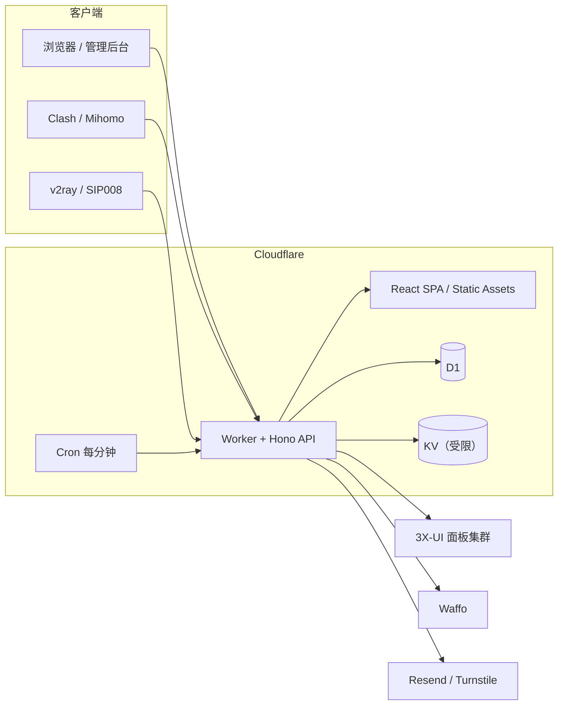

<div align="center">
  

  <h1>3XUI Manager</h1>

  <p><em>在 Cloudflare Workers 上管理 3X-UI 节点、套餐、订阅与账单</em></p>

  <p>
    <a href="./LICENSE"></a>
    
    
    
    
    
  </p>

  <p>
    <a href="./README.md">简体中文</a> ·
    <a href="./readmes/README_zh-TW.md">繁體中文</a> ·
    <a href="./readmes/README_en.md">English</a> ·
    <a href="./readmes/README_ja.md">日本語</a> ·
    <a href="./readmes/README_ko.md">한국어</a>
  </p>

  <p>
    <a href="#快速部署">快速部署</a> ·
    <a href="#手动部署">手动部署</a> ·
    <a href="#系统配置">配置</a> ·
    <a href="#设计架构">架构</a> ·
    <a href="#注意事项">注意事项</a>
  </p>
</div>

## 项目简介

3XUI Manager 把 3X-UI 的日常运营集中到一个 Cloudflare Worker内，支持：

- 节点探测、入站与客户端同步
- 套餐与用户、订单与余额
- 流量计量、配额管理和限制
- Clash / V2Ray / SIP008 订阅

3XUI Manager 适合自托管、单管理员或小团队运营多台 3X-UI 节点的场景。

## 功能一览

| 模块 | 能力 |
| --- | --- |
| **节点** | 多节点注册、连通性探测；从 3X-UI 同步入站；按 3X-UI 结构分节的入站编辑器；未托管的 JSON 键保存时原样保留 |
| **订阅** | Clash / Mihomo YAML、V2Ray Base64、Shadowsocks SIP008；`选择节点` 手动 `select` 分组；大陆节点优先排序；ETag / 304 |
| **套餐** | 注册、登录、邮箱验证；免费套餐；套餐绑定入站；升级时余额优先抵扣；管理员可创建用户并直接分配套餐 |
| **配额** | 每分钟采样节点流量；支持倍率、流量重置；D1 幂等事件；耗尽后禁用客户端，失败在后续 Cron 重试 |
| **支付** | Waffo 下单、签名验证、Webhook、订单查询；D1 结算锁；人工充值 / 退款生成 `manual` 订单与余额流水 |
| **运维** | 站内通知、可选邮件重试、推荐奖励、账户保留清理、Cron 生命周期维护、健康检查 |
| **管理** | 12 种界面语言、阿拉伯语 RTL、亮色 / 暗色 / 跟随系统、主题预设、响应式布局、搜索与分页 |
| **安全** | 会话 Cookie、同源校验、敏感字段加密、Turnstile 注册 / 签到校验、`/api/health` 能力检查 |

<details>
<summary><strong>订阅生成</strong>（点击展开）</summary>

- **Clash**：生成 `选择节点` 手动分组和规则分类分组，不生成 `url-test` 自动切换；每个分类仍可直接选具体节点。
- **排序**：大陆节点优先，同类按平台保存的顺序升序；管理列表、用户节点列表和三种订阅格式使用同一套排序数据。
- **凭据**：订阅只使用成功同步到节点的客户端映射；部分成功的入站只输出已确认的节点。
- **缓存**：响应带 ETag，客户端重新校验时返回 304，减少重复传输。

</details>

<details>
<summary><strong>计量配额</strong>（点击展开）</summary>

Cron 每分钟运行一次流量采样和权限对账。单轮最多处理 8 个节点，并发上限 4；节点更多时轮转采样。面板不可达或同步失败不会把节点误判为正常，相关客户端会在后续轮次重试。

D1 中的用量事件是幂等的，配额禁用和支付结算都通过 lease 串行化，避免同一账户的并发写入互相覆盖。

</details>

## 快速部署

| 平台 | 一键部署 | 状态 |
| --- | :---: | --- |
| Cloudflare Workers | [](https://deploy.workers.cloudflare.com/?url=https://github.com/PIKACHUIM/3XUI-Manager) | 已验证 |
| EdgeOne Makers | [](https://edgeone.ai/pages/new?project-name=3xui-manager&repository-url=https://github.com/PIKACHUIM/3XUI-Manager) | 入口已提供，运行时待适配 |
| Aliyun ESA | [](https://esa.console.aliyun.com/edge/function/list) | 入口已提供，运行时待适配 |
| Vercel | [](https://vercel.com/new/clone?repository-url=https://github.com/PIKACHUIM/3XUI-Manager) | 入口已提供，运行时待适配 |

> 一键部署只创建平台项目，不会自动创建 D1、执行迁移或填写 secrets。Cloudflare Workers 是当前已验证的生产路径；EdgeOne、ESA、Vercel 需要自行适配 Workers bindings、D1 和 Cron，不能视为可直接运行。

## 手动部署

<details>
<summary><strong>展开手动部署步骤</strong>（本地开发、配置与 Cloudflare 部署）</summary>

### 前置要求

- Node.js 20 或更高版本 + npm
- 一个 Cloudflare 账号（部署到 Workers 时需要）
- 一台可从公网访问的 3X-UI 面板（HTTPS 域名 + 用户名/密码或受限 API Token）
- 可选：Waffo 沙箱商户配置（只测试支付时需要）

<details>
<summary><strong>本地开发</strong>（点击展开）</summary>

```bash
git clone https://github.com/PIKACHUIM/3XUI-Manager.git
cd 3XUI-Manager
npm ci
npm run db:local
npm run dev
```

`npm run db:local` 会把 `migrations/` 应用到本地 D1。`npm run dev` 由 Vite Cloudflare 插件启动本地 Workers 预览，终端会输出实际访问地址。

在项目根目录创建被 Git 忽略的 `.dev.vars`，只放部署级密钥：

```dotenv
ADMIN_BOOTSTRAP_TOKEN="<首次管理员初始化用的长随机串>"
APP_ENCRYPTION_KEY="<至少 32 个字符，需长期保存>"
```

> `APP_ENCRYPTION_KEY` 用于加密面板凭据和系统设置中的敏感字段。更换前必须先设计并验证已有密文的重加密方案，否则旧凭据将无法解密。

业务配置（验证码、邮件、支付、签到、推荐奖励等）在管理员登录后的“系统设置”里填写，不写入 `.dev.vars`，也不要提交到仓库。

</details>

<details>
<summary><strong>配置系统</strong>（点击展开）</summary>

1. 打开本地开发地址，使用登录页的“首次管理员初始化”。
2. 输入 `ADMIN_BOOTSTRAP_TOKEN`，创建管理员账号；建成后该 Token 不再代替管理员登录凭据。
3. 在“节点列表”新增 3X-UI 节点，确认探测状态为在线。
4. 创建入站、套餐，并把套餐绑定到入站。
5. 按需配置 Turnstile、Resend、Waffo 和签到奖励。
6. 创建用户或让用户注册，检查订阅链接与客户端同步状态。

</details>

### 部署到 Cloudflare

### 1. 创建 D1 数据库

```bash
npx wrangler d1 create 3xuiwork-data
```

将命令输出中的 `database_id` 写入 `wrangler.jsonc` 的 `d1_databases[0].database_id`。保留 binding 名 `DB`、数据库名 `3xuiwork-data` 和 `migrations_dir: "migrations"`。

> 仓库里的 `wrangler.jsonc` 可能包含部署者的真实 ID。Fork 或自建时请替换为自己的 D1 ID，不要直接复用他人的数据库。

### 2. 登记 Worker secrets

```bash
npx wrangler secret put ADMIN_BOOTSTRAP_TOKEN
npx wrangler secret put APP_ENCRYPTION_KEY
```

这两项只在部署环境设置。Waffo 的 API Key、商户号、签名私钥和平台公钥现在通过管理员“系统设置”保存，不再读取同名 Worker 环境变量。

### 3. 数据迁移

迁移不会自动执行。先审阅 `migrations/` 中待应用的 SQL，导出备份，再由有生产权限的操作者应用：

```bash
npx wrangler d1 migrations list 3xuiwork-data --remote
npx wrangler d1 export 3xuiwork-data --remote --output d1-before-deploy.sql
npm run db:remote
```

`--remote` 会写入远程数据库。执行前请核对 Wrangler 登录账号、数据库名/ID、备份可用性和恢复责任人。

### 4. 构建发布

```bash
npm run typecheck
npm test
npm run deploy
```

`npm run deploy` 等价于 `npm run build && wrangler deploy`，会先构建前端静态资源，再发布 Worker、D1 绑定和 Cron 触发器。

### 5. 完成检查

1. 访问 `https://<你的域名>/api/health`，确认 D1 计量、配额强制和支付结算能力正常。
2. 完成首次管理员初始化并登录，确认会话 Cookie 与同源请求正常。
3. 新增节点并探测，确认 3X-UI 面板可达；Worker 不能访问裸 IP、私网或回环地址。
4. 在系统设置填写 `publicAppUrl`，必须是最终 HTTPS 源站，不带路径、凭据、查询或片段。
5. 在 Waffo 商户后台把通知地址设为 `https://<你的域名>/api/webhooks/waffo`，并用沙箱完成一次升级/回调验证。
6. 检查 Cron 执行日志、流量采样、订阅输出和节点客户端状态。

</details>

## 系统配置

### Worker 绑定与变量

| 名称 | 类型 | 必需 | 说明 |
| --- | --- | --- | --- |
| `DB` | D1 | 是 | 生产计量、配额、支付结算和订阅数据的核心存储 |
| `ASSETS` | Static Assets | 是 | React 管理端与用户端静态资源 |
| `APP_KV` | KV | 否 | 仅用于能力受限的部署；不能替代 D1 的原子能力 |
| `STORAGE_DRIVER` | Variable | 是 | 生产设为 `d1` |
| `APP_NAME` | Variable | 否 | 站点标题的默认值，可在系统设置中覆盖 |
| `ADMIN_BOOTSTRAP_TOKEN` | Secret | 首次初始化 | 只用于创建第一个管理员 |
| `APP_ENCRYPTION_KEY` | Secret | 是 | 加密面板凭据和系统设置敏感字段，至少 32 字符 |

<details>
<summary><strong>系统设置</strong>（点击展开）</summary>

| 设置 | 用途 |
| --- | --- |
| `publicAppUrl` | 站点 HTTPS 源站，用于支付回跳和 Webhook 地址校验 |
| `registrationEnabled` | 是否允许普通用户注册 |
| `turnstileSiteKey` / `turnstileSecretKey` | 注册与签到的 Turnstile 校验；后端同时校验 action 和请求主机名 |
| `resendApiKey` / `resendFrom` | 可选邮件投递；两者都配置后才发送通知邮件 |
| `waffoApiKey` / `waffoSigningKey` / `waffoPublicKey` | Waffo 请求签名与响应验签 |
| `waffoMerchantId` / `waffoEnvironment` | 商户号与运行环境；默认沙箱，设为 `production` 才请求生产 API |
| 签到奖励范围 | 按十进制 GB 配置上下限；服务端在包含两端的整数 Byte 范围内均匀随机 |
| `referralPercent` / `referralValidityDays` | 推荐奖励比例与有效天数 |
| 账户清理相关项 | 不活跃/无套餐清理阈值与预警天数；默认关闭 |

敏感字段使用 `APP_ENCRYPTION_KEY` 加密后保存。管理员读取设置时，秘密字段返回空字符串，并通过 `secretConfigured` 表示是否已配置；写入时省略或传空字符串保留旧值，传 `null` 清除，传非空字符串替换。

</details>

### Waffo 支付

<details>
<summary>展开查看 Waffo 配置、回调与交易行为</summary>

支付相关配置全部通过管理员 `PUT /api/admin/settings` 保存

| 设置 | 含义 |
| --- | --- |
| `waffoApiKey` | Waffo 商户后台签发的 API Key，随请求以 `X-API-KEY` 发送 |
| `waffoMerchantId` | 商户号，写入下单请求的 `merchantInfo.merchantId` |
| `waffoSigningKey` | 商户 RSA 私钥，建议 PKCS#8；用于对下单/查询请求体签名 |
| `waffoPublicKey` | Waffo 平台 RSA 公钥；用于验签响应与 Webhook |
| `publicAppUrl` | 生成 `notifyUrl` 与成功/失败/取消跳转地址，必须是 HTTPS 且与前端/API 同源 |
| `waffoEnvironment` | 省略或非 `production` 时请求沙箱，设为 `production` 才请求生产 API |

交易行为：

- 升级应付款先由账户余额抵扣；余额部分以 D1 流水 `balance_payment` 记账，并在同一事务内扣减。余额不足时只对差额创建 Waffo 订单，已抵扣金额记录在 `metadata.balanceAppliedMinor`。
- 订单关闭或过期时，已抵扣余额以 `balance_refund` 幂等退回；晚到的成功通知会在结算前重新核对。
- 支持的终态为 `PAY_SUCCESS` 和 `ORDER_CLOSE`；处理中状态只确认接收，不结算。
- Webhook 可能乱序。若成功通知到达时订单已被标记为失败或过期，应用会请求并验签 Waffo Order Inquiry，确认金额和币种后再结算。
- 管理员人工充值/退款不经过 Waffo：充值订单记为 `paid`，退款订单记为 `refunded`，只调整本地余额并写流水，不会产生真实收付款；人工充值不计入“本月收入”。
- 账户余额当前是单一数值，不区分币种；跨币种套餐应避免依赖余额。
- 仓库测试使用签名模拟响应，未完成真实商户环境的 Webhook / Inquiry 端到端验证；上线前必须用沙箱完整验证。

</details>

## 设计架构



| 层 | 技术 |
| --- | --- |
| 运行时 | Cloudflare Workers、Wrangler |
| 后端 | Hono、TypeScript、D1、KV（受限） |
| 前端 | React 19、Vite、Tailwind CSS 4、Recharts、Lucide |
| 测试 | Vitest、Wrangler 本地 D1 platform |
| 外部系统 | 3X-UI HTTP API、Waffo、Turnstile、Resend |

<details>
<summary><strong>项目结构</strong>（点击展开）</summary>

```text
src/
├─ api/          Hono 路由：auth / user / admin / payments / subscriptions
├─ services/     业务：计费、流量、生命周期、通知、订阅、节点同步、WireGuard
├─ adapters/     外部系统：3X-UI、Waffo
├─ domain/       类型、默认值、加密、WireGuard
├─ storage/      D1 / KV 文档存储
├─ worker/       Worker 入口与 Cron 调度
└─ client/       React 管理端与用户端
migrations/      D1 SQL 迁移
public/          图标等静态资源
wrangler.jsonc   Worker / D1 / KV / Cron 配置
```

</details>

<details>
<summary><strong>开发脚本</strong>（点击展开）</summary>

| 命令 | 说明 |
| --- | --- |
| `npm run dev` | 启动本地 Workers 预览 |
| `npm run build` | 构建 Worker 和前端静态资源 |
| `npm run preview` | 使用 `dist` 预览构建结果，需先执行 `build` |
| `npm run deploy` | 构建并发布到 Cloudflare |
| `npm run typecheck` | TypeScript 类型检查 |
| `npm test` | 运行 Vitest 测试 |
| `npm run db:local` | 应用本地 D1 迁移 |
| `npm run db:remote` | 应用远程 D1 迁移（人工确认后执行） |

</details>

## 注意事项

<details>
<summary>点击展开查看注意事项</summary>

- **存储限制**：D1 是生产必需项,KV 的 lease 是非原子读后写，不能提供 D1 级并发结算和事件幂等保证。当前支付 checkout 会拒绝非 D1 存储，流量采集会停止并报告不可用。
- **平台兼容**：项目基于 Wrangler、Workers bindings、D1 和 Cron 构建；Tencent EdgeOne、Alibaba Cloud ESA、Vercel 等运行时尚未逐项验证，不能视为可原样移植。
- **面板网络**：面板必须使用 HTTPS 域名。Worker 无法访问裸 IP、私网或回环地址；面板被防火墙拦截时，应放行 Cloudflare 出口或使用 Cloudflare Tunnel。
- **执行延迟**：Cron 每分钟运行，单轮最多 8 个节点、并发 4；节点更多时轮转采样，实际执行时间还受面板可用性和 D1 事件积压影响。
- **支付边界**：只接入 Waffo；沙箱为默认环境；真实商户 Webhook、完整 Inquiry payload 和 Waffo 重试行为未在商户环境端到端验证。支付成功跳转不能当作付款凭证，以签名验证后的服务端 Webhook 和订单状态为准。
- **登录验证**：仓库测试不包含真实第三方凭据；上线前必须配置有效 Site Key、Secret Key、widget 域名和发件域，并自行完成真实投递验证。
- **迁移回滚**：回滚 Worker 不会撤销已应用的 D1 migration。D1 Time Travel 恢复会原地覆盖数据库，属于破坏性操作，必须审批、停止写入、确认时间点并先保留当前状态。
- **密钥管理**：`APP_ENCRYPTION_KEY` 必须长期保存；不要在日志、Issue、截图或提交记录中暴露密钥、面板密码、UUID、订阅令牌或支付私钥。

</details>

<details>
<summary><strong>常见问题</strong>（点击展开）</summary>

| 现象 | 优先检查 |
| --- | --- |
| `/api/health` 报告 D1 不可用 | `wrangler.jsonc` 的 `DB` binding、`database_id`、迁移是否已应用 |
| 订阅返回 422 | 是否有满足套餐、已启用且成功同步的客户端；检查入站绑定与 `syncedNodes` |
| 面板探测超时 | 面板是否为 HTTPS 域名；防火墙是否放行 Cloudflare；是否使用了裸 IP/私网地址 |
| `Waffo returned an unverified response` | `waffoPublicKey` 是否为当前平台公钥，`waffoSigningKey` 是否为对应商户私钥 |
| 注册后收不到验证邮件 | `resendApiKey` 与 `resendFrom` 是否同时配置，发件域是否已验证 |
| 管理员无法登录 | 首次初始化只使用 `ADMIN_BOOTSTRAP_TOKEN`；之后使用创建的管理员邮箱和密码 |
| 订阅更新后节点仍失败 | 在客户端重新更新订阅，而不是只刷新节点列表；再检查面板客户端与节点同步状态 |

</details>

## 许可证

本项目基于 [AGPL-3.0](./LICENSE) 许可证开源。

如果你部署的是修改后的版本，请按 AGPL-3.0 的要求向用户提供对应源代码。

## 相关项目

- [3X-UI](https://github.com/MHSanaei/3x-ui)：面板与 Xray 管理
- [Hono](https://hono.dev)：边缘运行时 Web 框架
- [Cloudflare Workers](https://workers.cloudflare.com)：运行时与边缘网络
- [Waffo](https://waffo.com)：支付接入
