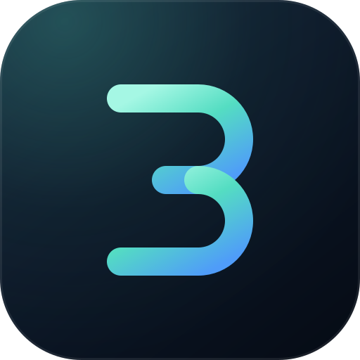
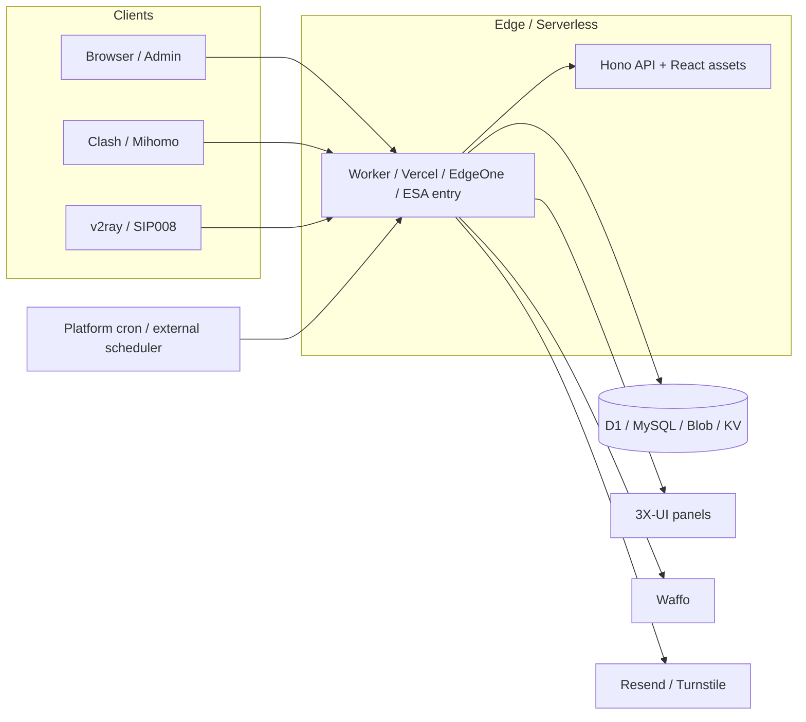

<div align="center">
  

  <h1>3XUI Manager</h1>

  <p><em>Manage 3X-UI nodes, plans, subscriptions and billing on Cloudflare Workers</em></p>

  <p>A single-origin full-stack platform: Hono API + React dashboard + D1 metering and settlement.</p>

  <p>
    <a href="../LICENSE"></a>
    
    
    
    
    
  </p>

  <p>
    <a href="../README.md">简体中文</a> ·
    <a href="./README_zh-TW.md">繁體中文</a> ·
    <strong>English</strong> ·
    <a href="./README_ja.md">日本語</a> ·
    <a href="./README_ko.md">한국어</a>
  </p>

  <p>
    <a href="#quick-deploy">Quick deploy</a> ·
    <a href="#manual-deployment">Manual deployment</a> ·
    <a href="#configuration">Configuration</a> ·
    <a href="#architecture">Architecture</a> ·
    <a href="#notes">Notes</a>
  </p>
</div>

## Overview

3XUI Manager brings day-to-day 3X-UI operations into one Cloudflare Worker: node probing, inbound and client synchronization, plans and users, orders and balances, traffic metering, quota enforcement, and Clash / V2Ray / SIP008 subscription output.

It is **not** a replacement for the 3X-UI panel. It is a management layer that talks to panels through the 3X-UI HTTP API. The dashboard, user portal, API and webhooks are served from the same origin, so they do not need to be split across domains.

It is intended for self-hosting, a single administrator, or a small team operating multiple 3X-UI nodes.

## Features

| Area | Capabilities |
| --- | --- |
| **Nodes & inbounds** | Register and probe multiple nodes; import inbounds from 3X-UI; edit inbounds in sections that mirror the panel; preserve unknown JSON keys |
| **Subscriptions** | Clash / Mihomo YAML, V2Ray Base64 and Shadowsocks SIP008; a manual `选择节点` (`Select nodes`) group; mainland-first ordering; ETag / 304 |
| **Users & plans** | Registration, login and email verification; free plan; plan-to-inbound bindings; balance-first upgrades; admins can create users and assign plans |
| **Metering & quota** | Per-minute traffic sampling; multipliers and traffic resets; idempotent D1 events; disable clients on exhaustion and retry on later Cron runs |
| **Orders & payments** | Waffo checkout, signature verification, webhooks and order inquiry; D1 settlement leases; manual credit / refund creates `manual` orders and ledger entries |
| **Operations** | In-app notifications, optional email retries, referral rewards, account retention cleanup, Cron lifecycle maintenance and health checks |
| **Experience** | 12 UI languages, Arabic RTL, light / dark / system themes, theme presets, responsive layout, search and pagination |
| **Security** | Session cookies, same-origin checks, encrypted sensitive fields, Turnstile for registration / check-in, `/api/health` capability checks |

<details>
<summary><strong>How subscriptions are generated</strong> (click to expand)</summary>

- **Clash / Mihomo**: generates the `选择节点` manual group and rule-category groups, without `url-test` auto-switching. Every category can still select a specific node.
- **Ordering**: mainland nodes come first, then the saved platform order within each group. Admin lists, user node lists and all subscription formats share the same ordering data.
- **Credentials**: only clients that were successfully synchronized to a node are emitted. A partially synchronized inbound only exposes confirmed nodes.
- **Caching**: responses carry an ETag and return 304 on revalidation to avoid retransmitting an unchanged profile.

</details>

<details>
<summary><strong>Metering and quota</strong> (click to expand)</summary>

Cron runs traffic sampling and entitlement reconciliation every minute. One run handles at most 8 nodes with concurrency 4; larger fleets rotate through batches. An unreachable panel or failed synchronization is never treated as healthy, and affected clients are retried on later runs.

Usage events in D1 are idempotent. Quota disabling and payment settlement are serialized with leases so concurrent writes for the same account cannot overwrite each other.

</details>

## Quick deploy

| Cloudflare Workers | EdgeOne Makers | Aliyun ESA | Vercel |
| :---: | :---: | :---: | :---: |
| [](https://deploy.workers.cloudflare.com/?url=https://github.com/PIKACHUIM/3XUI-Manager) | [](https://edgeone.ai/pages/new?project-name=3xui-manager&repository-url=https://github.com/PIKACHUIM/3XUI-Manager) | [](https://esa.console.aliyun.com/edge/function/list) | [](https://vercel.com/new/clone?repository-url=https://github.com/PIKACHUIM/3XUI-Manager) |

> One-click deploy only creates the platform project. It does not create a database, run migrations or fill secrets. Cloudflare uses D1, EdgeOne/ESA use Blob/KV, and Vercel uses remote MySQL. See [Manual deployment](#manual-deployment) and [Configuration](#configuration).

### Platform storage

| Platform | Storage | Configuration |
| --- | --- | --- |
| Cloudflare Workers | D1 (production) / KV (limited) | `DB` binding; `STORAGE_DRIVER=d1` |
| EdgeOne Makers | Blob / KV | `STORAGE_DRIVER=blob`; Blob SDK or `EO_KV` / `EO_BLOB` binding |
| Aliyun ESA | Blob / KV | `STORAGE_DRIVER=blob`; `ESA_BLOB` / `ESA_KV` binding |
| Vercel / Node | Remote MySQL | `STORAGE_DRIVER=mysql`; `MYSQL_URLS` or `MYSQL_HOST/MYSQL_NAME` |

Blob/KV and MySQL document mode support login, nodes, plans, subscriptions and client sync. **Atomic traffic metering, quota enforcement and Waffo settlement remain D1-only.** EdgeOne/ESA edge runtimes cannot open MySQL TCP connections; Vercel's Node runtime can.

## Manual deployment

<details>
<summary><strong>Expand manual deployment steps</strong> (local development, configuration and multi-platform deploy)</summary>

### Requirements

- Node.js 20 or newer + npm
- A Cloudflare account (required for Workers deployment)
- A publicly reachable 3X-UI panel (HTTPS hostname + username/password or a scoped API token)
- Optional: a Waffo sandbox merchant configuration (only for payment testing)

<details>
<summary><strong>Local development</strong> (click to expand)</summary>

```bash
git clone https://github.com/PIKACHUIM/3XUI-Manager.git
cd 3XUI-Manager
npm ci
npm run db:local
npm run dev
```

`npm run db:local` applies `migrations/` to the local D1 database. `npm run dev` starts the local Workers preview through the Vite Cloudflare plugin and prints the actual URL.

Create a Git-ignored `.dev.vars` file in the project root with deployment-level secrets only:

```dotenv
ADMIN_BOOTSTRAP_TOKEN="<long random token for the first admin setup>"
APP_ENCRYPTION_KEY="<at least 32 characters; keep it permanently>"
```

> `APP_ENCRYPTION_KEY` encrypts panel credentials and sensitive settings. Before rotating it, design and verify a re-encryption path for existing ciphertext, or old credentials will become unreadable.

Business settings (Turnstile, email, payments, check-in and referral rules) are configured in the admin **System settings** page. Do not put them in `.dev.vars`, and never commit them.

</details>

<details>
<summary><strong>Configure the system</strong> (click to expand)</summary>

1. Open the local development URL and use **First-time admin setup** on the login page.
2. Enter `ADMIN_BOOTSTRAP_TOKEN` to create the administrator. After that, the token is no longer a login credential.
3. Add a 3X-UI node in **Nodes** and confirm that probing reports it online.
4. Create an inbound and a plan, then bind the plan to the inbound.
5. Configure Turnstile, Resend, Waffo and check-in rewards as needed.
6. Create a user or let one register, then verify subscription links and client synchronization.

</details>

### Deploy to Cloudflare

### 1. Create the D1 database

```bash
npx wrangler d1 create 3xuiwork-data
```

Put the returned `database_id` into `d1_databases[0].database_id` in `wrangler.jsonc`. Keep the binding name `DB`, the database name `3xuiwork-data` and `migrations_dir: "migrations"`.

> `wrangler.jsonc` in this repository may contain the deployer's real ID. When forking or self-hosting, replace it with your own D1 ID and do not reuse someone else's database.

### 2. Register Worker secrets

```bash
npx wrangler secret put ADMIN_BOOTSTRAP_TOKEN
npx wrangler secret put APP_ENCRYPTION_KEY
```

These are deployment secrets only. Waffo API keys, merchant ID, signing key and platform public key are stored through **System settings** and are no longer read from Worker environment variables.

### 3. Apply database migrations

Migrations are never applied automatically. Review the pending SQL under `migrations/`, export a backup, then apply it as an operator with production access:

```bash
npx wrangler d1 migrations list 3xuiwork-data --remote
npx wrangler d1 export 3xuiwork-data --remote --output d1-before-deploy.sql
npm run db:remote
```

`--remote` writes to the remote database. Before running it, verify the Wrangler account, database name/ID, backup availability and the person responsible for recovery.

### 4. Build and deploy

```bash
npm run typecheck
npm test
npm run deploy
```

`npm run deploy` is equivalent to `npm run build && wrangler deploy`: it builds the frontend assets and then publishes the Worker, D1 binding and Cron trigger.

### 5. Post-deploy checks

1. Open `https://<your-domain>/api/health` and confirm D1 metering, quota enforcement and payment settlement are available.
2. Complete first-time admin setup and sign in; verify session cookies and same-origin requests.
3. Add and probe a node; the Worker cannot reach bare IPs, private networks or loopback addresses.
4. Set `publicAppUrl` in System settings to the final HTTPS origin, without a path, credentials, query or fragment.
5. Set the Waffo notification URL to `https://<your-domain>/api/webhooks/waffo` and complete a sandbox upgrade/callback test.
6. Check Cron logs, traffic sampling, subscription output and panel client state.

### Deploy to Vercel

1. Import the repository into Vercel. `vercel.json` sets `npm run build:vercel`, `dist/vercel`, API rewrites and a per-minute `/api/cron`.
2. Prepare remote MySQL and set `STORAGE_DRIVER=mysql` plus `MYSQL_URLS` (or `MYSQL_HOST/MYSQL_PORT/MYSQL_USER/MYSQL_PASS/MYSQL_NAME`).
3. Set `APP_ENCRYPTION_KEY`, `ADMIN_BOOTSTRAP_TOKEN`, `CRON_SECRET` and optional `APP_NAME`.
4. The app creates the `3xui_kv` document table automatically. Vercel Hobby may not allow a per-minute Cron; adjust `vercel.json` or use an external scheduler.

### Deploy to EdgeOne

1. Import the repository into EdgeOne Makers. `npm run build:edgeone` produces `dist/edgeone` and `edge-functions/api/[[default]].js`.
2. Bind Blob or KV and set `STORAGE_DRIVER=blob`; use `EO_BLOB_NAMESPACE` for Blob or `EO_KV` for KV.
3. Set `APP_ENCRYPTION_KEY`, `ADMIN_BOOTSTRAP_TOKEN`, `CRON_SECRET`.
4. EdgeOne native `schedules` have a one-day minimum interval. Use an external scheduler for per-minute `/api/cron`.

### Deploy to Aliyun ESA

1. Import the repository into ESA. `esa.jsonc` uses `dist/esa-entry.js` and the `dist/esa` assets.
2. Bind `ESA_BLOB` or `ESA_KV` and set `STORAGE_DRIVER=blob`.
3. Set `APP_ENCRYPTION_KEY`, `ADMIN_BOOTSTRAP_TOKEN`, `CRON_SECRET`.
4. ESA has no native per-minute Cron. Call `/api/cron` from an external scheduler with `x-cron-secret`. ESA edge functions have tight CPU/subrequest limits; keep heavy sync work on an external scheduler or Cloudflare Worker.

</details>

## Configuration

### Worker bindings and variables

| Name | Type | Required | Description |
| --- | --- | --- | --- |
| `DB` | D1 | Cloudflare | Core storage for metering, quota, payment settlement and subscriptions |
| `ASSETS` | Static Assets | Yes | React dashboard and user portal assets |
| `APP_KV` | KV | No | Cloudflare KV for limited deployments |
| `STORAGE_DRIVER` | Variable | Yes | `d1` / `mysql` / `blob` / `kv` |
| `APP_NAME` | Variable | No | Default site title, overridable in System settings |
| `ADMIN_BOOTSTRAP_TOKEN` | Secret | First setup | Used only to create the first administrator |
| `APP_ENCRYPTION_KEY` | Secret | Yes | Encrypts panel credentials and sensitive settings; at least 32 characters |

### Platform environment variables

| Variable | Platform | Description |
| --- | --- | --- |
| `STORAGE_DRIVER` | All | `d1` / `mysql` / `blob` / `kv` |
| `MYSQL_URLS` | Vercel / Node | Preferred MySQL connection string |
| `MYSQL_HOST` / `MYSQL_PORT` / `MYSQL_USER` / `MYSQL_PASS` / `MYSQL_NAME` | Vercel / Node | Split MySQL configuration |
| `CRON_SECRET` | Vercel / EdgeOne / ESA | Protects `/api/cron`; Vercel sends it as a Bearer token |
| `EO_KV` / `EO_BLOB` | EdgeOne | Platform KV/Blob binding; `STORAGE_DRIVER=blob` |
| `EO_BLOB_NAMESPACE` | EdgeOne | Blob namespace, default `default` |
| `ESA_BLOB` / `ESA_KV` | Aliyun ESA | ESA Blob/KV binding; `STORAGE_DRIVER=blob` |

See `.env.example` for Vercel/Node and `.dev.vars.example` for Cloudflare. Never commit real values.

<details>
<summary><strong>System settings</strong> (click to expand)</summary>

| Setting | Purpose |
| --- | --- |
| `publicAppUrl` | HTTPS origin used for payment redirects and webhook validation |
| `registrationEnabled` | Whether normal users may register |
| `turnstileSiteKey` / `turnstileSecretKey` | Turnstile checks for registration and check-in; the backend also validates the action and request hostname |
| `resendApiKey` / `resendFrom` | Optional email delivery; both are required before notification emails are sent |
| `waffoApiKey` / `waffoSigningKey` / `waffoPublicKey` | Waffo request signing and response verification |
| `waffoMerchantId` / `waffoEnvironment` | Merchant ID and environment; sandbox by default, `production` switches to the production API |
| Check-in reward range | Minimum and maximum in decimal GB; the server picks uniformly from the inclusive integer byte range |
| `referralPercent` / `referralValidityDays` | Referral reward percentage and validity period |
| Account cleanup settings | Inactive/no-plan thresholds and warning days; disabled by default |

Sensitive fields are encrypted with `APP_ENCRYPTION_KEY`. When an administrator reads settings, secret fields are returned as empty strings and `secretConfigured` reports whether they are set. On write, an omitted field or empty string keeps the old value, `null` clears it, and a non-empty string replaces it.

</details>

### Waffo payments

<details>
<summary>Waffo configuration, webhooks and transaction behavior</summary>

All payment settings are saved through the admin `PUT /api/admin/settings` endpoint.

| Setting | Meaning |
| --- | --- |
| `waffoApiKey` | API key issued by Waffo, sent as `X-API-KEY` |
| `waffoMerchantId` | Merchant ID written to `merchantInfo.merchantId` |
| `waffoSigningKey` | Merchant RSA private key, preferably PKCS#8, used to sign checkout/inquiry requests |
| `waffoPublicKey` | Waffo platform RSA public key, used to verify responses and webhooks |
| `publicAppUrl` | Generates `notifyUrl` and success/failure/cancel redirects; must be HTTPS and same-origin |
| `waffoEnvironment` | Omitted or non-`production` uses sandbox; `production` uses the production API |

Transaction behavior:

- Upgrades first consume the account balance. The balance portion is recorded as a `balance_payment` ledger entry and deducted in the same transaction. If the balance is insufficient, only the difference is charged through Waffo, with the applied amount stored in `metadata.balanceAppliedMinor`.
- When an order closes or expires, the applied balance is refunded idempotently as `balance_refund`. A late success notification re-checks the order before settlement.
- Terminal states are `PAY_SUCCESS` and `ORDER_CLOSE`. Processing states are acknowledged but not settled.
- Webhooks can arrive out of order. If a success notification arrives after an order was marked failed or expired, the app verifies a Waffo Order Inquiry response and checks amount and currency before settling.
- Manual admin credits/refunds bypass Waffo: credits are marked `paid`, refunds are marked `refunded`, and both only change the local balance and ledger. They do not move real money, and manual credits are excluded from "monthly revenue".
- Account balance is currently a single amount without a currency; avoid relying on balance for cross-currency plans.
- Tests use signed mock responses. Real merchant webhook/inquiry end-to-end validation is still required before production.

</details>

## Architecture



| Layer | Technology |
| --- | --- |
| Runtime | Cloudflare Workers, Vercel Node, EdgeOne Edge Functions, ESA Edge Functions |
| Backend | Hono, TypeScript |
| Storage | D1 (atomic), remote MySQL, EdgeOne/ESA Blob or KV |
| Frontend | React 19, Vite, Tailwind CSS 4, Recharts, Lucide |
| Testing | Vitest, Wrangler local D1 platform, storage adapter tests |
| External systems | 3X-UI HTTP API, Waffo, Turnstile, Resend |

<details>
<summary><strong>Project structure</strong> (click to expand)</summary>

```text
src/
├─ app.ts        Hono app and /api/cron
├─ api/          routes: auth / user / admin / payments / subscriptions
├─ services/     billing, traffic, lifecycle, notifications, subscriptions, node sync, WireGuard
├─ adapters/     external systems: 3X-UI, Waffo
├─ domain/       types, defaults, encryption, WireGuard
├─ storage/      D1 / MySQL / Blob / KV adapters
├─ platform/     Vercel / EdgeOne / ESA entries and env mapping
├─ worker/       Cloudflare entry and shared cron jobs
└─ client/       React dashboard and user portal
api/             Vercel Web Handler and cron function
migrations/      D1 SQL migrations
public/          icons and static assets
scripts/         EdgeOne / ESA function build scripts
wrangler.jsonc   Cloudflare Worker / D1 / KV / Cron configuration
vercel.json      Vercel build, routing and cron
edgeone.json     EdgeOne build and static assets
esa.jsonc        ESA entry and static assets
```

</details>

<details>
<summary><strong>Development scripts</strong> (click to expand)</summary>

| Command | Description |
| --- | --- |
| `npm run dev` | Start the local Workers preview |
| `npm run build` | Build the Worker and frontend assets |
| `npm run build:vercel` | Build the Vercel static frontend |
| `npm run build:edgeone` | Build the EdgeOne frontend and edge function |
| `npm run build:esa` | Build the ESA frontend and edge function |
| `npm run preview` | Preview the built `dist`, after running `build` |
| `npm run deploy` | Build and deploy to Cloudflare |
| `npm run typecheck` | TypeScript type checking |
| `npm test` | Run Vitest tests |
| `npm run db:local` | Apply local D1 migrations |
| `npm run db:remote` | Apply remote D1 migrations (after manual confirmation) |

</details>

## Notes

<details>
<summary>Click to expand the notes</summary>

- **Storage limit**: D1 still provides atomic traffic metering, quota enforcement and Waffo settlement. Blob/KV and MySQL document mode support login, nodes, plans, subscriptions and client sync, but disable checkout, check-in and atomic balance adjustments.
- **Platform compatibility**: Vercel, EdgeOne and ESA entries and build configs are provided; Vercel requires remote MySQL, while EdgeOne/ESA use Blob/KV. Bind resources, set secrets and complete end-to-end validation before treating any platform as production-ready.
- **Panel network**: panels must use an HTTPS hostname. Platform runtimes cannot fetch bare IPs, private networks or loopback addresses. If a firewall blocks the panel, allow the platform egress or use a Cloudflare Tunnel.
- **Execution latency**: Cloudflare/Vercel Cron runs every minute. EdgeOne native schedules have a one-day minimum, and ESA has no native per-minute cron; both need an external `/api/cron` scheduler. A run handles at most 8 nodes with concurrency 4.
- **Payment boundary**: only Waffo is integrated, and settlement is D1-only; sandbox is the default. Real merchant webhooks, the full inquiry payload and Waffo retries have not been validated end-to-end. A payment success redirect is not proof of payment; trust the signed server webhook and order state.
- **Login verification**: repository tests do not include real third-party credentials. Configure a valid Site Key, Secret Key, widget hostname and sending domain, and verify real delivery before going live.
- **Migrations and rollback**: rolling back the Worker does not undo applied D1 migrations. D1 Time Travel restore overwrites the database in place and is destructive; require approval, stop writes, confirm the timestamp and preserve the current state first. MySQL/Blob/KV document mode creates its own table/keys and has no D1 Time Travel equivalent.
- **Secrets**: keep `APP_ENCRYPTION_KEY` permanently. Never expose keys, panel passwords, UUIDs, subscription tokens or payment private keys in logs, issues, screenshots or commits.

</details>

<details>
<summary><strong>FAQ</strong> (click to expand)</summary>

| Symptom | Check first |
| --- | --- |
| `/api/health` reports D1 unavailable | `DB` binding, `database_id`, applied migrations |
| Subscription returns 422 | Whether an enabled, plan-eligible client was successfully synchronized; check inbound bindings and `syncedNodes` |
| Panel probe times out | HTTPS hostname, Cloudflare egress allowed by the firewall, no bare IP/private address |
| `Waffo returned an unverified response` | `waffoPublicKey` is the current platform key and `waffoSigningKey` matches the merchant |
| No verification email | `resendApiKey` and `resendFrom` are both set and the sending domain is verified |
| Admin cannot sign in | First setup uses `ADMIN_BOOTSTRAP_TOKEN`; afterwards use the created admin email and password |
| Nodes still fail after subscription update | Update the subscription in the client, not just refresh the node list; then check panel clients and node sync state |

</details>

## License

This project is licensed under [AGPL-3.0](../LICENSE).

If you deploy a modified version, provide the corresponding source code to your users as required by AGPL-3.0.

## Related projects

- [3X-UI](https://github.com/MHSanaei/3x-ui): panel and Xray management
- [Hono](https://hono.dev): web framework for edge runtimes
- [Cloudflare Workers](https://workers.cloudflare.com): runtime and edge network
- [Waffo](https://waffo.com): payment integration
