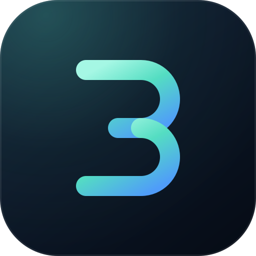
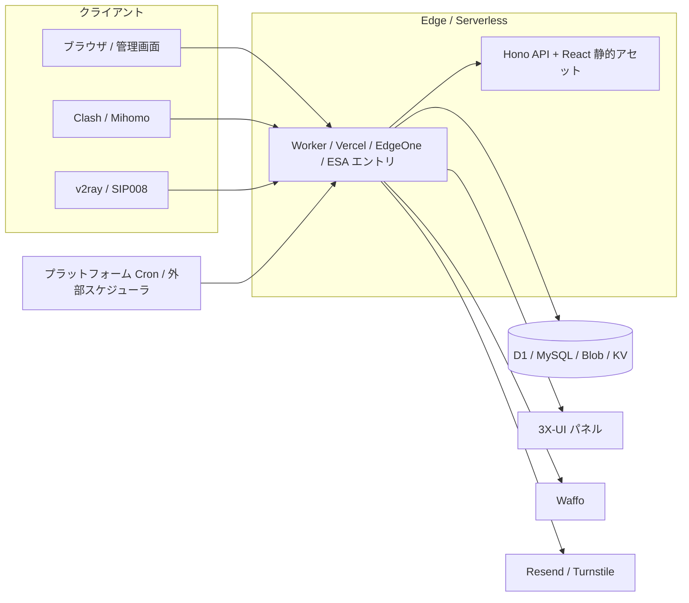

<div align="center">
  

  <h1>3XUI Manager</h1>

  <p><em>Cloudflare Workers 上で 3X-UI のノード、プラン、サブスクリプション、請求を管理</em></p>

  <p>同一オリジンのフルスタック管理プラットフォーム：Hono API + React 管理画面 + D1 の計測と決済。</p>

  <p>
    <a href="../LICENSE"></a>
    
    
    
    
    
  </p>

  <p>
    <a href="../README.md">简体中文</a> ·
    <a href="./README_zh-TW.md">繁體中文</a> ·
    <a href="./README_en.md">English</a> ·
    <strong>日本語</strong> ·
    <a href="./README_ko.md">한국어</a>
  </p>

  <p>
    <a href="#クイックデプロイ">クイックデプロイ</a> ·
    <a href="#手動デプロイ">手動デプロイ</a> ·
    <a href="#システム構成">設定</a> ·
    <a href="#アーキテクチャ">アーキテクチャ</a> ·
    <a href="#注意事項">注意事項</a>
  </p>
</div>

## 概要

3XUI Manager は、3X-UI の日々の運用を 1 つの Cloudflare Worker に集約します。ノードの疎通確認、インバウンドとクライアントの同期、プランとユーザー、注文と残高、トラフィック計測、クォータ強制、Clash / V2Ray / SIP008 のサブスクリプション出力を担当します。

これは 3X-UI パネルの代替ではありません。3X-UI HTTP API を通じてパネルを管理する上位レイヤーです。管理画面、ユーザーポータル、API、Webhook は同一オリジンで提供されるため、別ドメインに分割する必要はありません。

セルフホスト、単一管理者、または複数の 3X-UI ノードを運用する小規模チーム向けです。

## 機能

| 領域 | できること |
| --- | --- |
| **ノードとインバウンド** | 複数ノードの登録と疎通確認、3X-UI からのインバウンド同期、パネルと同じ区分のインバウンドエディタ、未知の JSON キーを保持 |
| **サブスクリプション** | Clash / Mihomo YAML、V2Ray Base64、Shadowsocks SIP008、`选择节点`（ノード選択）手動グループ、大陸ノード優先、ETag / 304 |
| **ユーザーとプラン** | 登録、ログイン、メール確認、無料プラン、プランとインバウンドの紐付け、残高優先のアップグレード、管理者によるユーザー作成とプラン割り当て |
| **計測とクォータ** | 毎分のトラフィックサンプリング、倍率とトラフィックリセット、D1 の冪等イベント、枯渇時のクライアント無効化と次回 Cron での再試行 |
| **注文と決済** | Waffo のチェックアウト、署名検証、Webhook、注文照会、D1 決済リース、手動チャージ / 返金による `manual` 注文と残高履歴 |
| **運用** | アプリ内通知、任意のメール再試行、紹介報酬、アカウント保持クリーンアップ、Cron ライフサイクル、ヘルスチェック |
| **管理画面** | 12 言語、アラビア語 RTL、ライト / ダーク / システムテーマ、テーマプリセット、レスポンシブ、検索、ページネーション |
| **セキュリティ** | セッション Cookie、同一オリジン検査、機密フィールドの暗号化、登録 / チェックインの Turnstile、`/api/health` 能力チェック |

<details>
<summary><strong>サブスクリプションの生成</strong>（クリックで展開）</summary>

- **Clash / Mihomo**：`选择节点` 手動グループとルールカテゴリグループを生成し、`url-test` の自動切り替えは作りません。各カテゴリから具体的なノードを手動選択できます。
- **並び順**：大陸ノードを先にし、同カテゴリ内はプラットフォームに保存された順序の昇順です。管理一覧、ユーザーのノード一覧、3 形式のサブスクリプションで同じ並び順データを使います。
- **認証情報**：ノードへの同期に成功したクライアントだけを出力します。部分的に成功したインバウンドは、確認済みのノードだけを公開します。
- **キャッシュ**：ETag を返し、再検証時は 304 を返して変更のないプロファイルの再送を避けます。

</details>

<details>
<summary><strong>計測とクォータ</strong>（クリックで展開）</summary>

Cron は毎分、トラフィックサンプリングと権限の突き合わせを実行します。1 回の実行で最大 8 ノード、同時実行 4 です。ノードが多い場合はローテーションします。パネルに到達できない場合や同期に失敗した場合は正常扱いせず、対象クライアントを後続の実行で再試行します。

D1 の使用量イベントは冪等です。クォータ無効化と決済はリースで直列化され、同一アカウントの同時書き込みが互いを上書きしません。

</details>

## クイックデプロイ

| Cloudflare Workers | EdgeOne Makers | Aliyun ESA | Vercel |
| :---: | :---: | :---: | :---: |
| [](https://deploy.workers.cloudflare.com/?url=https://github.com/PIKACHUIM/3XUI-Manager) | [](https://edgeone.ai/pages/new?project-name=3xui-manager&repository-url=https://github.com/PIKACHUIM/3XUI-Manager) | [](https://esa.console.aliyun.com/edge/function/list) | [](https://vercel.com/new/clone?repository-url=https://github.com/PIKACHUIM/3XUI-Manager) |

> ワンクリックデプロイはプラットフォームプロジェクトを作成するだけです。データベース、マイグレーション、secrets は自動作成されません。Cloudflare は D1、EdgeOne/ESA は Blob/KV、Vercel はリモート MySQL を使用します。[手動デプロイ](#手動デプロイ)と[システム構成](#システム構成)を参照してください。

### プラットフォームストレージ

| プラットフォーム | ストレージ | 設定 |
| --- | --- | --- |
| Cloudflare Workers | D1（本番）/ KV（制限付き） | `DB` binding；`STORAGE_DRIVER=d1` |
| EdgeOne Makers | Blob / KV | `STORAGE_DRIVER=blob`；Blob SDK または `EO_KV` / `EO_BLOB` binding |
| Aliyun ESA | Blob / KV | `STORAGE_DRIVER=blob`；`ESA_BLOB` / `ESA_KV` binding |
| Vercel / Node | リモート MySQL | `STORAGE_DRIVER=mysql`；`MYSQL_URLS` または `MYSQL_HOST/MYSQL_NAME` |

Blob/KV と MySQL ドキュメントモードはログイン、ノード、プラン、サブスクリプション、クライアント同期に対応します。**原子トラフィック計測、クォータ強制、Waffo 決済は D1 のみ**です。EdgeOne/ESA の Edge ランタイムは MySQL に直接接続できず、Vercel の Node ランタイムはリモート MySQL を利用できます。

## 手動デプロイ

<details>
<summary><strong>手動デプロイ手順を展開</strong>（ローカル開発、設定、マルチプラットフォームデプロイ）</summary>

### 前提条件

- Node.js 20 以上 + npm
- Cloudflare アカウント（Workers へのデプロイに必要）
- 公開ネットワークから到達できる 3X-UI パネル（HTTPS ホスト名 + ユーザー名/パスワードまたは限定 API Token）
- 任意：Waffo サンドボックスのマーチャント設定（決済テスト時のみ）

<details>
<summary><strong>ローカル開発</strong>（クリックで展開）</summary>

```bash
git clone https://github.com/PIKACHUIM/3XUI-Manager.git
cd 3XUI-Manager
npm ci
npm run db:local
npm run dev
```

`npm run db:local` は `migrations/` をローカル D1 に適用します。`npm run dev` は Vite Cloudflare プラグイン経由でローカル Workers プレビューを起動し、実際の URL を表示します。

プロジェクトルートに Git 管理外の `.dev.vars` を作成し、デプロイ用シークレットだけを置きます。

```dotenv
ADMIN_BOOTSTRAP_TOKEN="<初回管理者セットアップ用の長いランダム文字列>"
APP_ENCRYPTION_KEY="<32 文字以上。永続保存が必要>"
```

> `APP_ENCRYPTION_KEY` はパネル認証情報と機密設定の暗号化に使います。ローテーションする前に、既存の暗号文を再暗号化する手順を設計・検証してください。そうしないと古い認証情報を復号できなくなります。

ビジネス設定（Turnstile、メール、決済、チェックイン、紹介報酬など）は管理者の「システム設定」で入力します。`.dev.vars` には書かず、リポジトリにもコミットしないでください。

</details>

<details>
<summary><strong>初期設定</strong>（クリックで展開）</summary>

1. ローカル開発 URL を開き、ログイン画面の「初回管理者セットアップ」を使います。
2. `ADMIN_BOOTSTRAP_TOKEN` を入力して管理者を作成します。作成後、この Token はログイン認証情報として使えません。
3. 「ノード一覧」で 3X-UI ノードを追加し、疎通確認がオンラインになることを確認します。
4. インバウンドとプランを作成し、プランをインバウンドに紐付けます。
5. 必要に応じて Turnstile、Resend、Waffo、チェックイン報酬を設定します。
6. ユーザーを作成するか登録させ、サブスクリプションリンクとクライアント同期を確認します。

</details>

### Cloudflare へのデプロイ

### 1. D1 データベースを作成

```bash
npx wrangler d1 create 3xuiwork-data
```

出力された `database_id` を `wrangler.jsonc` の `d1_databases[0].database_id` に設定します。binding 名 `DB`、データベース名 `3xuiwork-data`、`migrations_dir: "migrations"` は維持してください。

> このリポジトリの `wrangler.jsonc` にはデプロイ担当者の実 ID が含まれている場合があります。Fork やセルフホスト時は自分の D1 ID に置き換え、他人のデータベースを再利用しないでください。

### 2. Worker secrets を登録

```bash
npx wrangler secret put ADMIN_BOOTSTRAP_TOKEN
npx wrangler secret put APP_ENCRYPTION_KEY
```

この 2 つはデプロイ環境だけに設定します。Waffo の API Key、マーチャント ID、署名秘密鍵、プラットフォーム公開鍵は管理者の「システム設定」で保存され、同名の Worker 環境変数は読みません。

### 3. データベースマイグレーションを適用

マイグレーションは自動実行されません。`migrations/` の未適用 SQL を確認し、バックアップを出力してから、本番権限を持つ担当者が適用します。

```bash
npx wrangler d1 migrations list 3xuiwork-data --remote
npx wrangler d1 export 3xuiwork-data --remote --output d1-before-deploy.sql
npm run db:remote
```

`--remote` はリモートデータベースへ書き込みます。実行前に Wrangler のアカウント、データベース名/ID、バックアップの可用性、復旧責任者を確認してください。

### 4. ビルドとデプロイ

```bash
npm run typecheck
npm test
npm run deploy
```

`npm run deploy` は `npm run build && wrangler deploy` と同じです。フロントエンドの静的アセットをビルドし、Worker、D1 binding、Cron トリガーを公開します。

### 5. デプロイ後の確認

1. `https://<your-domain>/api/health` を開き、D1 の計測、クォータ強制、決済能力が正常であることを確認します。
2. 初回管理者セットアップを完了してログインし、セッション Cookie と同一オリジンリクエストを確認します。
3. ノードを追加して疎通確認します。Worker は裸 IP、プライベートネットワーク、ループバックアドレスへアクセスできません。
4. システム設定の `publicAppUrl` を最終的な HTTPS オリジンにします。パス、認証情報、クエリ、フラグメントは含めません。
5. Waffo の通知 URL を `https://<your-domain>/api/webhooks/waffo` に設定し、サンドボックスでアップグレード / コールバックを検証します。
6. Cron ログ、トラフィックサンプリング、サブスクリプション出力、パネルクライアント状態を確認します。

### Vercel へのデプロイ

1. Vercel にリポジトリをインポートします。`vercel.json` が `npm run build:vercel`、`dist/vercel`、API rewrite、毎分 `/api/cron` を設定します。
2. リモート MySQL を用意し、`STORAGE_DRIVER=mysql` と `MYSQL_URLS`（または `MYSQL_HOST/MYSQL_PORT/MYSQL_USER/MYSQL_PASS/MYSQL_NAME`）を設定します。
3. `APP_ENCRYPTION_KEY`、`ADMIN_BOOTSTRAP_TOKEN`、`CRON_SECRET`、任意の `APP_NAME` を設定します。
4. アプリは `3xui_kv` テーブルを自動作成します。Vercel Hobby では毎分 Cron が使えない場合があるため、`vercel.json` を調整するか外部スケジューラを使用してください。

### EdgeOne へのデプロイ

1. EdgeOne Makers にリポジトリをインポートします。`npm run build:edgeone` が `dist/edgeone` と `edge-functions/api/[[default]].js` を生成します。
2. Blob または KV をバインドし、`STORAGE_DRIVER=blob` を設定します。Blob は `EO_BLOB_NAMESPACE`、KV は `EO_KV` を使用します。
3. `APP_ENCRYPTION_KEY`、`ADMIN_BOOTSTRAP_TOKEN`、`CRON_SECRET` を設定します。
4. EdgeOne の `schedules` は最小間隔が 1 日です。毎分同期が必要な場合は外部スケジューラから `/api/cron` を呼び出してください。

### Aliyun ESA へのデプロイ

1. ESA にリポジトリをインポートします。`esa.jsonc` は `dist/esa-entry.js` と `dist/esa` の静的アセットを使用します。
2. `ESA_BLOB` または `ESA_KV` をバインドし、`STORAGE_DRIVER=blob` を設定します。
3. `APP_ENCRYPTION_KEY`、`ADMIN_BOOTSTRAP_TOKEN`、`CRON_SECRET` を設定します。
4. ESA には毎分 Cron がありません。外部スケジューラから `x-cron-secret` 付きで `/api/cron` を呼び出してください。ESA は CPU/サブリクエスト制限が厳しいため、重い同期処理は外部に任せてください。

</details>

## システム構成

### Worker のバインディングと変数

| 名前 | 種類 | 必須 | 説明 |
| --- | --- | --- | --- |
| `DB` | D1 | Cloudflare | 計測、クォータ、決済、サブスクリプションの中心ストレージ |
| `ASSETS` | Static Assets | はい | React 管理画面とユーザーポータルの静的アセット |
| `APP_KV` | KV | いいえ | Cloudflare KV。制限付きデプロイ専用 |
| `STORAGE_DRIVER` | Variable | はい | `d1` / `mysql` / `blob` / `kv` |
| `APP_NAME` | Variable | いいえ | サイトタイトルの既定値。システム設定で上書き可能 |
| `ADMIN_BOOTSTRAP_TOKEN` | Secret | 初回セットアップ | 最初の管理者作成にのみ使用 |
| `APP_ENCRYPTION_KEY` | Secret | はい | パネル認証情報と機密設定を暗号化。32 文字以上 |

### プラットフォーム環境変数

| 変数 | プラットフォーム | 説明 |
| --- | --- | --- |
| `STORAGE_DRIVER` | すべて | `d1` / `mysql` / `blob` / `kv` |
| `MYSQL_URLS` | Vercel / Node | 優先する MySQL 接続文字列 |
| `MYSQL_HOST` / `MYSQL_PORT` / `MYSQL_USER` / `MYSQL_PASS` / `MYSQL_NAME` | Vercel / Node | MySQL の分割設定 |
| `CRON_SECRET` | Vercel / EdgeOne / ESA | `/api/cron` を保護。Vercel は Bearer で送信 |
| `EO_KV` / `EO_BLOB` | EdgeOne | プラットフォーム KV/Blob binding；`STORAGE_DRIVER=blob` |
| `EO_BLOB_NAMESPACE` | EdgeOne | Blob 名前空間。既定は `default` |
| `ESA_BLOB` / `ESA_KV` | Aliyun ESA | ESA Blob/KV binding；`STORAGE_DRIVER=blob` |

Vercel/Node は `.env.example`、Cloudflare ローカルは `.dev.vars.example` を参照してください。実際の値をコミットしないでください。

<details>
<summary><strong>システム設定</strong>（クリックで展開）</summary>

| 設定 | 用途 |
| --- | --- |
| `publicAppUrl` | 決済リダイレクトと Webhook 検証に使う HTTPS オリジン |
| `registrationEnabled` | 一般ユーザーの登録を許可するか |
| `turnstileSiteKey` / `turnstileSecretKey` | 登録とチェックインの Turnstile 検証。バックエンドは action とリクエストホストも検証 |
| `resendApiKey` / `resendFrom` | 任意のメール配信。両方設定した場合のみ通知メールを送信 |
| `waffoApiKey` / `waffoSigningKey` / `waffoPublicKey` | Waffo のリクエスト署名とレスポンス検証 |
| `waffoMerchantId` / `waffoEnvironment` | マーチャント ID と環境。既定はサンドボックス、`production` で本番 API |
| チェックイン報酬範囲 | 10 進 GB で下限/上限を設定。サーバーは両端を含む整数 Byte 範囲から一様に選択 |
| `referralPercent` / `referralValidityDays` | 紹介報酬の割合と有効日数 |
| アカウントクリーンアップ | 非アクティブ / プランなしのしきい値と予告日数。既定は無効 |

機密フィールドは `APP_ENCRYPTION_KEY` で暗号化して保存します。管理者が設定を読むと、秘密フィールドは空文字列で返り、`secretConfigured` が設定済みかどうかを示します。書き込み時は省略または空文字列で旧値を保持し、`null` で消去、非空文字列で置換します。

</details>

### Waffo 決済

<details>
<summary>Waffo の設定、Webhook、取引動作</summary>

決済設定はすべて管理者の `PUT /api/admin/settings` で保存します。

| 設定 | 意味 |
| --- | --- |
| `waffoApiKey` | Waffo が発行する API Key。`X-API-KEY` として送信 |
| `waffoMerchantId` | マーチャント ID。`merchantInfo.merchantId` に設定 |
| `waffoSigningKey` | マーチャントの RSA 秘密鍵。PKCS#8 推奨。チェックアウト / 照会リクエストの署名に使用 |
| `waffoPublicKey` | Waffo プラットフォームの RSA 公開鍵。レスポンスと Webhook の検証に使用 |
| `publicAppUrl` | `notifyUrl` と成功/失敗/キャンセルのリダイレクトを生成。HTTPS かつ同一オリジン必須 |
| `waffoEnvironment` | 省略または `production` 以外はサンドボックス。`production` で本番 API |

取引動作：

- アップグレードはまずアカウント残高を消費します。残高部分は `balance_payment` の台帳エントリとして記録し、同一トランザクションで減算します。残高不足時は差額だけを Waffo で決済し、適用額を `metadata.balanceAppliedMinor` に保存します。
- 注文が閉じるか期限切れになると、適用済み残高を `balance_refund` として冪等に返金します。遅延した成功通知は決済前に再確認します。
- 終端状態は `PAY_SUCCESS` と `ORDER_CLOSE` です。処理中状態は受理だけ行い、決済しません。
- Webhook は順序が前後する可能性があります。成功通知が失敗/期限切れ注文に届いた場合、Waffo Order Inquiry を検証し、金額と通貨を確認してから決済します。
- 管理者の手動チャージ / 返金は Waffo を通りません。チャージは `paid`、返金は `refunded` として記録され、ローカル残高と台帳だけを変更します。実際の入出金は発生せず、手動チャージは「今月の収益」に含まれません。
- アカウント残高は現在単一の数値で、通貨を持ちません。通貨をまたぐプランでは残高に依存しないでください。
- リポジトリのテストは署名付きモックレスポンスを使います。実際のマーチャント環境での Webhook / Inquiry エンドツーエンド検証は未完了で、本番前にサンドボックスで完全に検証する必要があります。

</details>

## アーキテクチャ



| レイヤー | 技術 |
| --- | --- |
| ランタイム | Cloudflare Workers、Vercel Node、EdgeOne Edge Functions、ESA Edge Functions |
| バックエンド | Hono、TypeScript |
| ストレージ | D1（原子性）、リモート MySQL、EdgeOne/ESA Blob または KV |
| フロントエンド | React 19、Vite、Tailwind CSS 4、Recharts、Lucide |
| テスト | Vitest、Wrangler ローカル D1 platform、ストレージアダプタテスト |
| 外部システム | 3X-UI HTTP API、Waffo、Turnstile、Resend |

<details>
<summary><strong>プロジェクト構成</strong>（クリックで展開）</summary>

```text
src/
├─ app.ts        Hono アプリと /api/cron
├─ api/          ルート：auth / user / admin / payments / subscriptions
├─ services/     課金、トラフィック、ライフサイクル、通知、サブスクリプション、ノード同期、WireGuard
├─ adapters/     外部システム：3X-UI、Waffo
├─ domain/       型、既定値、暗号化、WireGuard
├─ storage/      D1 / MySQL / Blob / KV アダプタ
├─ platform/     Vercel / EdgeOne / ESA エントリと環境マッピング
├─ worker/       Cloudflare エントリと共有 Cron
└─ client/       React 管理画面とユーザーポータル
api/             Vercel Web Handler と Cron
migrations/      D1 SQL マイグレーション
public/          アイコンなどの静的アセット
scripts/         EdgeOne / ESA ビルドスクリプト
wrangler.jsonc   Cloudflare Worker / D1 / KV / Cron
vercel.json      Vercel ビルド、ルーティング、Cron
edgeone.json     EdgeOne ビルドと静的アセット
esa.jsonc        ESA エントリと静的アセット
```

</details>

<details>
<summary><strong>開発スクリプト</strong>（クリックで展開）</summary>

| コマンド | 説明 |
| --- | --- |
| `npm run dev` | ローカル Workers プレビューを起動 |
| `npm run build` | Worker とフロントエンドをビルド |
| `npm run build:vercel` | Vercel 用静的フロントエンドをビルド |
| `npm run build:edgeone` | EdgeOne 用フロントエンドと Edge Function をビルド |
| `npm run build:esa` | ESA 用フロントエンドと Edge Function をビルド |
| `npm run preview` | ビルド済み `dist` をプレビュー。先に `build` が必要 |
| `npm run deploy` | ビルドして Cloudflare へデプロイ |
| `npm run typecheck` | TypeScript 型チェック |
| `npm test` | Vitest テストを実行 |
| `npm run db:local` | ローカル D1 マイグレーションを適用 |
| `npm run db:remote` | リモート D1 マイグレーションを適用（手動確認後） |

</details>

## 注意事項

<details>
<summary>クリックして注意事項を展開</summary>

- **ストレージ制限**：D1 は原子トラフィック計測、クォータ強制、Waffo 決済を提供します。Blob/KV と MySQL ドキュメントモードはログイン、ノード、プラン、サブスクリプション、クライアント同期に対応しますが、checkout、チェックイン、原子的な残高調整は無効です。
- **プラットフォーム互換性**：Vercel、EdgeOne、ESA の入口とビルド設定を提供しています。Vercel はリモート MySQL、EdgeOne/ESA は Blob/KV が必要です。実環境でバインディング、secrets、エンドツーエンド検証を完了してください。
- **パネルのネットワーク**：パネルは HTTPS ホスト名必須です。各ランタイムは裸 IP、プライベートネットワーク、ループバックへアクセスできません。遮断される場合はプラットフォームの出口を許可するか、Cloudflare Tunnel を使用してください。
- **実行遅延**：Cloudflare/Vercel の Cron は毎分実行されます。EdgeOne の schedules は最小 1 日、ESA には毎分 Cron がないため、外部から `/api/cron` を呼び出してください。1 回最大 8 ノード、同時実行 4 です。
- **決済の境界**：Waffo のみ対応し、決済は D1 のみです。既定はサンドボックスで、実際のマーチャント Webhook、Inquiry payload、Waffo の再試行はエンドツーエンド未検証です。決済成功リダイレクトを支払いの証拠にせず、署名検証済みのサーバー Webhook と注文状態を信頼してください。
- **ログイン検証**：リポジトリのテストに実際の第三者認証情報は含まれません。有効な Site Key、Secret Key、widget ホスト名、送信ドメインを設定し、本番前に実配信を検証してください。
- **マイグレーションとロールバック**：Worker のロールバックでは適用済み D1 migration は戻りません。D1 Time Travel の復元は破壊的です。MySQL/Blob/KV は独自のテーブル/キーを作成し、D1 Time Travel 相当の復元はありません。
- **シークレット管理**：`APP_ENCRYPTION_KEY` は永久に保存してください。キー、パネルパスワード、UUID、サブスクリプショントークン、決済秘密鍵をログ、Issue、スクリーンショット、コミットに露出させないでください。

</details>

<details>
<summary><strong>FAQ</strong>（クリックで展開）</summary>

| 症状 | 最初に確認すること |
| --- | --- |
| `/api/health` が D1 利用不可を報告 | `DB` binding、`database_id`、migration の適用状況 |
| サブスクリプションが 422 | プラン対象で有効、かつ同期成功したクライアントがあるか。インバウンド binding と `syncedNodes` を確認 |
| パネル疎通がタイムアウト | HTTPS ホスト名か、Cloudflare の出口が許可されているか、裸 IP/プライベートアドレスでないか |
| `Waffo returned an unverified response` | `waffoPublicKey` が現在のプラットフォーム鍵か、`waffoSigningKey` が対応するマーチャント鍵か |
| 確認メールが届かない | `resendApiKey` と `resendFrom` の両方が設定され、送信ドメインが検証済みか |
| 管理者がログインできない | 初回は `ADMIN_BOOTSTRAP_TOKEN`。以降は作成した管理者メールとパスワードを使用 |
| サブスクリプション更新後もノードが失敗 | ノード一覧の再読み込みではなく、クライアントでサブスクリプションを更新。その後パネルクライアントと同期状態を確認 |

</details>

## ライセンス

このプロジェクトは [AGPL-3.0](../LICENSE) で公開されています。

改変版をデプロイする場合は、AGPL-3.0 の要件に従って対応するソースコードをユーザーに提供してください。

## 関連プロジェクト

- [3X-UI](https://github.com/MHSanaei/3x-ui)：パネルと Xray 管理
- [Hono](https://hono.dev)：エッジランタイム向け Web フレームワーク
- [Cloudflare Workers](https://workers.cloudflare.com)：ランタイムとエッジネットワーク
- [Waffo](https://waffo.com)：決済連携
