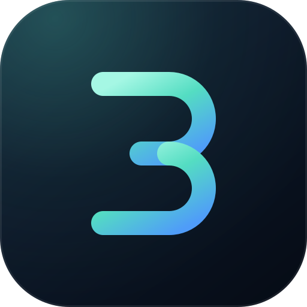
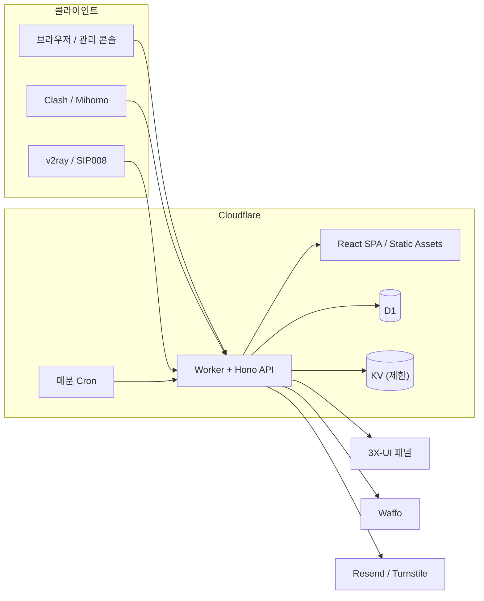

<div align="center">
  

  <h1>3XUI Manager</h1>

  <p><em>Cloudflare Workers에서 3X-UI 노드, 요금제, 구독, 결제를 관리</em></p>

  <p>동일 오리진 풀스택 관리 플랫폼: Hono API + React 관리 콘솔 + D1 계측 및 정산.</p>

  <p>
    <a href="../LICENSE"></a>
    
    
    
    
    
  </p>

  <p>
    <a href="https://deploy.workers.cloudflare.com/?url=https://github.com/PIKACHUIM/3XUI-Manager">
      
    </a>
  </p>
  <p><sub>원클릭 배포는 Worker만 생성합니다. D1, 데이터베이스 마이그레이션, Worker secrets는 아래에서 직접 설정해야 합니다.</sub></p>

  <p>
    <a href="../README.md">简体中文</a> ·
    <a href="./README_zh-TW.md">繁體中文</a> ·
    <a href="./README_en.md">English</a> ·
    <a href="./README_ja.md">日本語</a> ·
    <strong>한국어</strong>
  </p>

  <p>
    <a href="#빠른-시작">빠른 시작</a> ·
    <a href="#cloudflare-배포">배포</a> ·
    <a href="#시스템-구성">설정</a> ·
    <a href="#아키텍처">아키텍처</a> ·
    <a href="#주의-사항">주의 사항</a>
  </p>
</div>

## 개요

3XUI Manager는 3X-UI의 일상 운영을 하나의 Cloudflare Worker에 모읍니다. 노드 연결 확인, 인바운드와 클라이언트 동기화, 요금제와 사용자, 주문과 잔액, 트래픽 계측, 할당량 강제, Clash / V2Ray / SIP008 구독 출력을 담당합니다.

이 프로젝트는 3X-UI 패널을 대체하지 않습니다. 3X-UI HTTP API를 통해 패널을 관리하는 상위 계층입니다. 관리 콘솔, 사용자 포털, API, Webhook은 동일 오리진에서 제공되므로 서로 다른 도메인으로 나눌 필요가 없습니다.

셀프 호스팅, 단일 관리자, 또는 여러 3X-UI 노드를 운영하는 소규모 팀에 적합합니다.

## 기능

| 영역 | 기능 |
| --- | --- |
| **노드와 인바운드** | 여러 노드 등록과 연결 확인, 3X-UI에서 인바운드 가져오기, 패널 구조를 따른 인바운드 편집기, 알 수 없는 JSON 키 보존 |
| **구독 출력** | Clash / Mihomo YAML, V2Ray Base64, Shadowsocks SIP008, `选择节点`(노드 선택) 수동 그룹, 중국 본토 노드 우선 정렬, ETag / 304 |
| **사용자와 요금제** | 회원가입, 로그인, 이메일 인증, 무료 요금제, 요금제와 인바운드 연결, 잔액 우선 업그레이드, 관리자의 사용자 생성 및 요금제 할당 |
| **계측과 할당량** | 매분 트래픽 샘플링, 배율과 트래픽 초기화, D1 멱등 이벤트, 소진 시 클라이언트 비활성화 및 다음 Cron 재시도 |
| **주문과 결제** | Waffo 결제 생성, 서명 검증, Webhook, 주문 조회, D1 정산 리스, 수동 충전 / 환불 시 `manual` 주문과 잔액 원장 생성 |
| **운영** | 앱 내 알림, 선택적 이메일 재시도, 추천 보상, 계정 보존 정리, Cron 수명 주기 유지보수, 상태 확인 |
| **관리 경험** | 12개 UI 언어, 아랍어 RTL, 라이트 / 다크 / 시스템 테마, 테마 프리셋, 반응형 레이아웃, 검색과 페이지네이션 |
| **보안** | 세션 Cookie, 동일 오리진 검사, 민감 필드 암호화, 가입 / 출석 체크 Turnstile, `/api/health` 기능 확인 |

### 구독 생성 방식

- **Clash / Mihomo**: `选择节点` 수동 그룹과 규칙 카테고리 그룹을 생성하며 `url-test` 자동 전환은 만들지 않습니다. 각 카테고리에서 특정 노드를 직접 선택할 수 있습니다.
- **정렬**: 중국 본토 노드가 먼저 오고, 같은 그룹에서는 플랫폼에 저장된 순서의 오름차순입니다. 관리 목록, 사용자 노드 목록, 세 가지 구독 형식이 같은 정렬 데이터를 사용합니다.
- **자격 증명**: 노드에 성공적으로 동기화된 클라이언트만 출력합니다. 부분적으로 성공한 인바운드는 확인된 노드만 노출합니다.
- **캐시**: ETag를 반환하고 재검증 시 304를 반환하여 변경되지 않은 프로필의 재전송을 줄입니다.

### 계측과 할당량

Cron은 매분 트래픽 샘플링과 권한 대사를 실행합니다. 한 번에 최대 8개 노드, 동시성 4이며, 노드가 많으면 순환 처리합니다. 패널에 연결할 수 없거나 동기화에 실패한 노드는 정상으로 처리하지 않고 이후 실행에서 해당 클라이언트를 재시도합니다.

D1의 사용량 이벤트는 멱등입니다. 할당량 비활성화와 결제 정산은 리스로 직렬화되어 같은 계정의 동시 쓰기가 서로를 덮어쓰지 않습니다.

## 빠른 시작

### 사전 요구 사항

- Node.js 20 이상 + npm
- Cloudflare 계정 (Workers 배포 시 필요)
- 공용 네트워크에서 접근 가능한 3X-UI 패널 (HTTPS 호스트명 + 사용자 이름/비밀번호 또는 제한된 API Token)
- 선택 사항: Waffo 샌드박스 가맹점 설정 (결제 테스트 시에만 필요)

<details>
<summary><strong>로컬 개발</strong> (클릭하여 펼치기)</summary>

```bash
git clone https://github.com/PIKACHUIM/3XUI-Manager.git
cd 3XUI-Manager
npm ci
npm run db:local
npm run dev
```

`npm run db:local`은 `migrations/`를 로컬 D1에 적용합니다. `npm run dev`는 Vite Cloudflare 플러그인을 통해 로컬 Workers 미리보기를 시작하고 실제 URL을 출력합니다.

프로젝트 루트에 Git에서 무시되는 `.dev.vars` 파일을 만들고 배포 수준 secret만 넣습니다.

```dotenv
ADMIN_BOOTSTRAP_TOKEN="<최초 관리자 설정에 사용할 긴 무작위 문자열>"
APP_ENCRYPTION_KEY="<32자 이상, 영구 보관 필요>"
```

> `APP_ENCRYPTION_KEY`는 패널 자격 증명과 민감한 시스템 설정을 암호화합니다. 교체하기 전에 기존 암호문을 다시 암호화하는 절차를 설계하고 검증해야 합니다. 그렇지 않으면 기존 자격 증명을 복호화할 수 없습니다.

비즈니스 설정(Turnstile, 이메일, 결제, 출석 체크, 추천 보상 등)은 관리자 로그인 후 "시스템 설정"에서 입력합니다. `.dev.vars`에 넣지 말고 저장소에도 커밋하지 마세요.

</details>

### 초기 설정

1. 로컬 개발 URL을 열고 로그인 화면의 "최초 관리자 설정"을 사용합니다.
2. `ADMIN_BOOTSTRAP_TOKEN`을 입력해 관리자를 생성합니다. 생성 후 이 Token은 로그인 자격 증명으로 사용할 수 없습니다.
3. "노드 목록"에서 3X-UI 노드를 추가하고 연결 확인이 온라인인지 확인합니다.
4. 인바운드와 요금제를 만들고 요금제를 인바운드에 연결합니다.
5. 필요에 따라 Turnstile, Resend, Waffo, 출석 체크 보상을 설정합니다.
6. 사용자를 만들거나 가입하게 한 뒤 구독 링크와 클라이언트 동기화를 확인합니다.

## Cloudflare 배포

### 1. D1 데이터베이스 생성

```bash
npx wrangler d1 create 3xuiwork-data
```

출력된 `database_id`를 `wrangler.jsonc`의 `d1_databases[0].database_id`에 넣습니다. binding 이름 `DB`, 데이터베이스 이름 `3xuiwork-data`, `migrations_dir: "migrations"`는 유지하세요.

> 이 저장소의 `wrangler.jsonc`에는 배포자의 실제 ID가 들어 있을 수 있습니다. Fork하거나 직접 호스팅할 때는 자신의 D1 ID로 바꾸고 다른 사람의 데이터베이스를 재사용하지 마세요.

### 2. Worker secrets 등록

```bash
npx wrangler secret put ADMIN_BOOTSTRAP_TOKEN
npx wrangler secret put APP_ENCRYPTION_KEY
```

이 두 항목은 배포 환경에만 설정합니다. Waffo의 API Key, 가맹점 ID, 서명 개인 키, 플랫폼 공개 키는 관리자 "시스템 설정"으로 저장되며 같은 이름의 Worker 환경 변수를 읽지 않습니다.

### 3. 데이터베이스 마이그레이션 적용

마이그레이션은 자동으로 실행되지 않습니다. `migrations/`의 대기 중인 SQL을 검토하고 백업을 내보낸 뒤, 운영 권한이 있는 담당자가 적용합니다.

```bash
npx wrangler d1 migrations list 3xuiwork-data --remote
npx wrangler d1 export 3xuiwork-data --remote --output d1-before-deploy.sql
npm run db:remote
```

`--remote`는 원격 데이터베이스에 씁니다. 실행 전에 Wrangler 계정, 데이터베이스 이름/ID, 백업 가용성, 복구 책임자를 확인하세요.

### 4. 빌드 및 배포

```bash
npm run typecheck
npm test
npm run deploy
```

`npm run deploy`는 `npm run build && wrangler deploy`와 같습니다. 프런트엔드 정적 자산을 빌드한 뒤 Worker, D1 binding, Cron 트리거를 배포합니다.

### 5. 배포 후 확인

1. `https://<your-domain>/api/health`를 열고 D1 계측, 할당량 강제, 결제 정산 기능이 정상인지 확인합니다.
2. 최초 관리자 설정을 완료하고 로그인하여 세션 Cookie와 동일 오리진 요청을 확인합니다.
3. 노드를 추가하고 연결을 확인합니다. Worker는 원시 IP, 사설 네트워크, 루프백 주소에 접근할 수 없습니다.
4. 시스템 설정의 `publicAppUrl`을 최종 HTTPS 오리진으로 설정합니다. 경로, 자격 증명, 쿼리, 프래그먼트는 포함하지 않습니다.
5. Waffo 알림 URL을 `https://<your-domain>/api/webhooks/waffo`로 설정하고 샌드박스에서 업그레이드 / 콜백을 검증합니다.
6. Cron 로그, 트래픽 샘플링, 구독 출력, 패널 클라이언트 상태를 확인합니다.

## 시스템 구성

### Worker 바인딩 및 변수

| 이름 | 유형 | 필수 | 설명 |
| --- | --- | --- | --- |
| `DB` | D1 | 예 | 계측, 할당량, 결제 정산, 구독 데이터의 핵심 저장소 |
| `ASSETS` | Static Assets | 예 | React 관리 콘솔과 사용자 포털 정적 자산 |
| `APP_KV` | KV | 아니요 | 제한된 배포 전용. D1의 원자성을 대체할 수 없음 |
| `STORAGE_DRIVER` | Variable | 예 | 운영 환경은 `d1` |
| `APP_NAME` | Variable | 아니요 | 사이트 제목 기본값. 시스템 설정에서 변경 가능 |
| `ADMIN_BOOTSTRAP_TOKEN` | Secret | 최초 설정 | 첫 관리자 생성에만 사용 |
| `APP_ENCRYPTION_KEY` | Secret | 예 | 패널 자격 증명과 민감 설정 암호화. 32자 이상 |

### 시스템 설정

| 설정 | 용도 |
| --- | --- |
| `publicAppUrl` | 결제 리디렉션과 Webhook 검증에 사용하는 HTTPS 오리진 |
| `registrationEnabled` | 일반 사용자 가입 허용 여부 |
| `turnstileSiteKey` / `turnstileSecretKey` | 가입과 출석 체크의 Turnstile 검증. 백엔드는 action과 요청 호스트도 확인 |
| `resendApiKey` / `resendFrom` | 선택적 이메일 발송. 둘 다 설정해야 알림 메일을 보냄 |
| `waffoApiKey` / `waffoSigningKey` / `waffoPublicKey` | Waffo 요청 서명과 응답 검증 |
| `waffoMerchantId` / `waffoEnvironment` | 가맹점 ID와 환경. 기본은 샌드박스, `production`이면 운영 API |
| 출석 체크 보상 범위 | 10진수 GB로 하한/상한 설정. 서버는 양 끝을 포함한 정수 Byte 범위에서 균등 무작위 선택 |
| `referralPercent` / `referralValidityDays` | 추천 보상 비율과 유효 기간 |
| 계정 정리 관련 항목 | 비활성/요금제 없음 정리 기준과 경고 일수. 기본 비활성 |

민감 필드는 `APP_ENCRYPTION_KEY`로 암호화해 저장합니다. 관리자가 설정을 읽으면 secret 필드는 빈 문자열로 반환되고 `secretConfigured`가 설정 여부를 나타냅니다. 쓸 때 생략하거나 빈 문자열을 보내면 기존 값을 유지하고, `null`은 삭제, 비어 있지 않은 문자열은 교체합니다.

### Waffo 결제

<details>
<summary>Waffo 설정, Webhook, 거래 동작</summary>

결제 설정은 모두 관리자 `PUT /api/admin/settings`로 저장합니다.

| 설정 | 의미 |
| --- | --- |
| `waffoApiKey` | Waffo가 발급한 API Key. `X-API-KEY`로 전송 |
| `waffoMerchantId` | 가맹점 ID. `merchantInfo.merchantId`에 기록 |
| `waffoSigningKey` | 가맹점 RSA 개인 키. PKCS#8 권장. 결제/조회 요청 본문 서명에 사용 |
| `waffoPublicKey` | Waffo 플랫폼 RSA 공개 키. 응답과 Webhook 검증에 사용 |
| `publicAppUrl` | `notifyUrl`과 성공/실패/취소 리디렉션 생성. HTTPS이며 동일 오리진이어야 함 |
| `waffoEnvironment` | 생략하거나 `production`이 아니면 샌드박스, `production`이면 운영 API |

거래 동작:

- 업그레이드는 먼저 계정 잔액을 사용합니다. 잔액 부분은 `balance_payment` 원장 항목으로 기록하고 같은 트랜잭션에서 차감합니다. 잔액이 부족하면 차액만 Waffo로 결제하며, 적용 금액은 `metadata.balanceAppliedMinor`에 저장합니다.
- 주문이 닫히거나 만료되면 적용된 잔액을 `balance_refund`로 멱등 환불합니다. 늦게 도착한 성공 알림은 정산 전에 주문을 다시 확인합니다.
- 최종 상태는 `PAY_SUCCESS`와 `ORDER_CLOSE`입니다. 처리 중 상태는 접수만 하고 정산하지 않습니다.
- Webhook 순서는 바뀔 수 있습니다. 성공 알림이 실패/만료 주문에 도착하면 Waffo Order Inquiry를 검증하고 금액과 통화를 확인한 뒤 정산합니다.
- 관리자 수동 충전/환불은 Waffo를 거치지 않습니다. 충전은 `paid`, 환불은 `refunded`로 기록되며 로컬 잔액과 원장만 변경합니다. 실제 입출금은 발생하지 않고 수동 충전은 "이번 달 수익"에 포함되지 않습니다.
- 계정 잔액은 현재 단일 값이며 통화를 구분하지 않습니다. 통화가 다른 요금제에서는 잔액에 의존하지 마세요.
- 저장소 테스트는 서명된 모의 응답을 사용합니다. 실제 가맹점 환경의 Webhook / Inquiry 종단 간 검증은 완료되지 않았으며, 운영 전 샌드박스에서 충분히 검증해야 합니다.

</details>

## 아키텍처



| 계층 | 기술 |
| --- | --- |
| 런타임 | Cloudflare Workers, Wrangler |
| 백엔드 | Hono, TypeScript, D1, KV(제한) |
| 프런트엔드 | React 19, Vite, Tailwind CSS 4, Recharts, Lucide |
| 테스트 | Vitest, Wrangler 로컬 D1 platform |
| 외부 시스템 | 3X-UI HTTP API, Waffo, Turnstile, Resend |

<details>
<summary><strong>프로젝트 구조</strong> (클릭하여 펼치기)</summary>

```text
src/
├─ api/          Hono 라우트: auth / user / admin / payments / subscriptions
├─ services/     과금, 트래픽, 수명 주기, 알림, 구독, 노드 동기화, WireGuard
├─ adapters/     외부 시스템: 3X-UI, Waffo
├─ domain/       타입, 기본값, 암호화, WireGuard
├─ storage/      D1 / KV 문서 저장소
├─ worker/       Worker 진입점과 Cron 스케줄
└─ client/       React 관리 콘솔과 사용자 포털
migrations/      D1 SQL 마이그레이션
public/          아이콘 등 정적 자산
wrangler.jsonc   Worker / D1 / KV / Cron 설정
```

</details>

<details>
<summary><strong>개발 스크립트</strong> (클릭하여 펼치기)</summary>

| 명령 | 설명 |
| --- | --- |
| `npm run dev` | 로컬 Workers 미리보기 시작 |
| `npm run build` | Worker와 프런트엔드 정적 자산 빌드 |
| `npm run preview` | 빌드된 `dist` 미리보기. 먼저 `build` 필요 |
| `npm run deploy` | 빌드 후 Cloudflare에 배포 |
| `npm run typecheck` | TypeScript 타입 검사 |
| `npm test` | Vitest 테스트 실행 |
| `npm run db:local` | 로컬 D1 마이그레이션 적용 |
| `npm run db:remote` | 원격 D1 마이그레이션 적용(수동 확인 후) |

</details>

## 주의 사항

- **저장소 제한**: 운영 환경에는 D1이 필수입니다. KV의 lease는 비원자적 read-modify-write이며 D1 수준의 동시 정산과 이벤트 멱등성을 제공할 수 없습니다. 현재 checkout은 비 D1 저장소를 거부하고 트래픽 수집은 중단되어 사용할 수 없음을 보고합니다.
- **플랫폼 호환성**: Wrangler, Workers bindings, D1, Cron에 의존합니다. Tencent EdgeOne, Alibaba Cloud ESA 같은 런타임은 검증되지 않았으며 그대로 실행된다고 볼 수 없습니다.
- **패널 네트워크**: 패널은 HTTPS 호스트명을 사용해야 합니다. Worker는 원시 IP, 사설 네트워크, 루프백 주소에 접근할 수 없습니다. 방화벽이 막으면 Cloudflare egress를 허용하거나 Cloudflare Tunnel을 사용하세요.
- **실행 지연**: Cron은 매분 실행되며 한 번에 최대 8개 노드, 동시성 4입니다. 노드가 많으면 순환 처리하며 실제 시점은 패널 가용성과 D1 이벤트 적체에도 영향을 받습니다.
- **결제 경계**: Waffo만 연동하며 기본은 샌드박스입니다. 실제 가맹점 Webhook, 전체 Inquiry payload, Waffo 재시도는 종단 간 검증되지 않았습니다. 결제 성공 리디렉션을 결제 증거로 보지 말고 서명 검증된 서버 Webhook과 주문 상태를 신뢰하세요.
- **로그인 검증**: 저장소 테스트에는 실제 제3자 자격 증명이 없습니다. 유효한 Site Key, Secret Key, widget 호스트명, 발신 도메인을 설정하고 운영 전에 실제 발송을 검증하세요.
- **마이그레이션과 롤백**: Worker를 롤백해도 적용된 D1 migration은 되돌아가지 않습니다. D1 Time Travel 복원은 데이터베이스를 덮어쓰는 파괴적 작업입니다. 승인, 쓰기 중지, 시점 확인, 현재 상태 보존을 먼저 해야 합니다.
- **Secret 관리**: `APP_ENCRYPTION_KEY`는 영구 보관하세요. 키, 패널 비밀번호, UUID, 구독 토큰, 결제 개인 키를 로그, Issue, 스크린샷, 커밋에 노출하지 마세요.

<details>
<summary><strong>FAQ</strong> (클릭하여 펼치기)</summary>

| 증상 | 먼저 확인할 것 |
| --- | --- |
| `/api/health`가 D1 사용 불가를 보고 | `DB` binding, `database_id`, migration 적용 여부 |
| 구독이 422 반환 | 요금제 대상이며 활성화되고 동기화에 성공한 클라이언트가 있는지. 인바운드 binding과 `syncedNodes` 확인 |
| 패널 연결 시간 초과 | HTTPS 호스트명인지, 방화벽이 Cloudflare를 허용하는지, 원시 IP/사설 주소가 아닌지 |
| `Waffo returned an unverified response` | `waffoPublicKey`가 현재 플랫폼 키인지, `waffoSigningKey`가 해당 가맹점 키인지 |
| 인증 메일이 오지 않음 | `resendApiKey`와 `resendFrom`이 모두 설정되고 발신 도메인이 검증되었는지 |
| 관리자가 로그인할 수 없음 | 최초에는 `ADMIN_BOOTSTRAP_TOKEN`, 이후에는 생성한 관리자 이메일과 비밀번호 사용 |
| 구독 갱신 후에도 노드 실패 | 노드 목록 새로고침이 아니라 클라이언트에서 구독을 갱신한 뒤 패널 클라이언트와 동기화 상태 확인 |

</details>

## 라이선스

이 프로젝트는 [AGPL-3.0](../LICENSE) 라이선스로 공개됩니다.

수정한 버전을 배포하는 경우 AGPL-3.0 요구 사항에 따라 사용자에게 해당 소스 코드를 제공해야 합니다.

## 관련 프로젝트

- [3X-UI](https://github.com/MHSanaei/3x-ui): 패널과 Xray 관리
- [Hono](https://hono.dev): 엣지 런타임 웹 프레임워크
- [Cloudflare Workers](https://workers.cloudflare.com): 런타임과 엣지 네트워크
- [Waffo](https://waffo.com): 결제 연동
