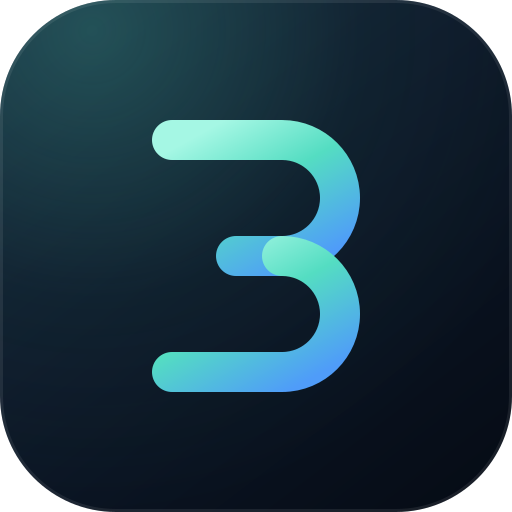
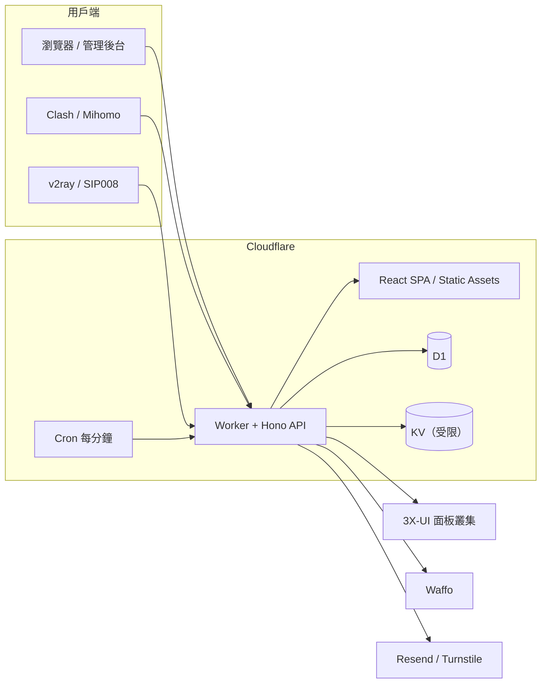

<div align="center">
  

  <h1>3XUI Manager</h1>

  <p><em>在 Cloudflare Workers 上管理 3X-UI 節點、方案、訂閱與帳務</em></p>

  <p>一個同源的全端管理平台：Hono API + React 管理端 + D1 計量與結算。</p>

  <p>
    <a href="../LICENSE"></a>
    
    
    
    
    
  </p>

  <p>
    <a href="../README.md">简体中文</a> ·
    <strong>繁體中文</strong> ·
    <a href="./README_en.md">English</a> ·
    <a href="./README_ja.md">日本語</a> ·
    <a href="./README_ko.md">한국어</a>
  </p>

  <p>
    <a href="#快速部署">快速部署</a> ·
    <a href="#手動部署">手動部署</a> ·
    <a href="#系統設定">設定</a> ·
    <a href="#設計架構">架構</a> ·
    <a href="#注意事項">注意事項</a>
  </p>
</div>

## 專案簡介

3XUI Manager 將 3X-UI 的日常營運集中到一個 Cloudflare Worker：節點探測、入站與用戶端同步、方案與使用者、訂單與餘額、流量計量、配額強制，以及 Clash / V2Ray / SIP008 訂閱輸出。

它**不是** 3X-UI 面板的替代品，而是透過 3X-UI HTTP API 管理面板的上層平台。管理端、使用者端、API 與 Webhook 同源部署，不需要拆到不同網域。

適合自架、單一管理員或小團隊營運多台 3X-UI 節點的場景。

## 功能一覽

| 模組 | 能力 |
| --- | --- |
| **節點入站** | 多節點註冊、連通性探測；從 3X-UI 同步入站；依 3X-UI 結構分節的入站編輯器；未託管的 JSON 鍵儲存時原樣保留 |
| **訂閱輸出** | Clash / Mihomo YAML、V2Ray Base64、Shadowsocks SIP008；`选择节点`（選擇節點）手動 `select` 分組；大陸節點優先排序；ETag / 304 |
| **使用者方案** | 註冊、登入、電子郵件驗證；免費方案；方案綁定入站；升級時餘額優先抵扣；管理員可建立使用者並直接分配方案 |
| **計量配額** | 每分鐘取樣節點流量；支援倍率、流量重置；D1 冪等事件；耗盡後停用用戶端，失敗在後續 Cron 重試 |
| **訂單支付** | Waffo 下單、簽章驗證、Webhook、訂單查詢；D1 結算鎖；人工儲值 / 退款產生 `manual` 訂單與餘額流水 |
| **維運工具** | 站內通知、可選郵件重試、推薦獎勵、帳戶保留清理、Cron 生命週期維護、健康檢查 |
| **管理體驗** | 12 種介面語言、阿拉伯語 RTL、亮色 / 暗色 / 跟隨系統、主題預設、響應式版面、搜尋與分頁 |
| **安全防護** | 工作階段 Cookie、同源檢查、敏感欄位加密、Turnstile 註冊 / 簽到驗證、`/api/health` 能力檢查 |

<details>
<summary><strong>訂閱是怎麼生成的</strong>（點擊展開）</summary>

- **Clash / Mihomo**：產生 `选择节点` 手動分組與規則分類分組，不產生 `url-test` 自動切換；每個分類仍可直接選擇具體節點。
- **排序**：大陸節點優先，同類依平台儲存的順序升冪；管理清單、使用者節點清單與三種訂閱格式使用同一套排序資料。
- **憑證**：訂閱只使用成功同步到節點的用戶端映射；部分成功的入站只輸出已確認的節點。
- **快取**：回應帶 ETag，用戶端重新驗證時回傳 304，減少重複傳輸。

</details>

<details>
<summary><strong>計量與配額</strong>（點擊展開）</summary>

Cron 每分鐘執行一次流量取樣與權限對帳。單輪最多處理 8 個節點，併發上限 4；節點更多時輪替取樣。面板無法連線或同步失敗不會被誤判為正常，相關用戶端會在後續輪次重試。

D1 中的用量事件是冪等的，配額停用與支付結算都透過 lease 串行化，避免同一帳戶的併發寫入互相覆蓋。

</details>

## 快速部署

| 平台 | 一鍵部署 | 狀態 |
| --- | :---: | --- |
| Cloudflare Workers | [](https://deploy.workers.cloudflare.com/?url=https://github.com/PIKACHUIM/3XUI-Manager) | 已驗證 |
| EdgeOne Makers | [](https://edgeone.ai/pages/new?project-name=3xui-manager&repository-url=https://github.com/PIKACHUIM/3XUI-Manager) | 入口已提供，執行環境待適配 |
| Aliyun ESA | [](https://esa.console.aliyun.com/edge/function/list) | 入口已提供，執行環境待適配 |
| Vercel | [](https://vercel.com/new/clone?repository-url=https://github.com/PIKACHUIM/3XUI-Manager) | 入口已提供，執行環境待適配 |

> 一鍵部署只會建立平台專案，不會自動建立 D1、執行遷移或填寫 secrets。Cloudflare Workers 是目前已驗證的生產路徑；EdgeOne、ESA、Vercel 需要自行適配 Workers bindings、D1 與 Cron，不能視為可直接執行。

## 手動部署

<details>
<summary><strong>展開手動部署步驟</strong>（本地開發、設定與 Cloudflare 部署）</summary>

### 前置需求

- Node.js 20 或更新版本 + npm
- 一個 Cloudflare 帳號（部署到 Workers 時需要）
- 一台可從公網存取的 3X-UI 面板（HTTPS 網域 + 使用者名稱/密碼或受限 API Token）
- 選用：Waffo 沙箱商戶設定（只測試支付時需要）

<details>
<summary><strong>本地開發</strong>（點擊展開）</summary>

```bash
git clone https://github.com/PIKACHUIM/3XUI-Manager.git
cd 3XUI-Manager
npm ci
npm run db:local
npm run dev
```

`npm run db:local` 會把 `migrations/` 套用到本地 D1。`npm run dev` 由 Vite Cloudflare 外掛啟動本地 Workers 預覽，終端機會輸出實際網址。

在專案根目錄建立被 Git 忽略的 `.dev.vars`，只放部署層級密鑰：

```dotenv
ADMIN_BOOTSTRAP_TOKEN="<首次管理員初始化用的長隨機字串>"
APP_ENCRYPTION_KEY="<至少 32 個字元，需長期保存>"
```

> `APP_ENCRYPTION_KEY` 用於加密面板憑證與系統設定中的敏感欄位。更換前必須先設計並驗證既有密文的重加密方案，否則舊憑證將無法解密。

業務設定（驗證碼、郵件、支付、簽到、推薦獎勵等）在管理員登入後的「系統設定」填寫，不寫入 `.dev.vars`，也不要提交到倉庫。

</details>

<details>
<summary><strong>設定系統</strong>（點擊展開）</summary>

1. 開啟本地開發網址，使用登入頁的「首次管理員初始化」。
2. 輸入 `ADMIN_BOOTSTRAP_TOKEN` 建立管理員帳號；建立後該 Token 不再代替管理員登入憑證。
3. 在「節點清單」新增 3X-UI 節點，確認探測狀態為線上。
4. 建立入站、方案，並把方案綁定到入站。
5. 視需要設定 Turnstile、Resend、Waffo 與簽到獎勵。
6. 建立使用者或讓使用者註冊，檢查訂閱連結與用戶端同步狀態。

</details>

### 部署到 Cloudflare

### 1. 建立 D1 資料庫

```bash
npx wrangler d1 create 3xuiwork-data
```

將指令輸出中的 `database_id` 寫入 `wrangler.jsonc` 的 `d1_databases[0].database_id`。保留 binding 名稱 `DB`、資料庫名稱 `3xuiwork-data` 與 `migrations_dir: "migrations"`。

> 倉庫裡的 `wrangler.jsonc` 可能包含部署者的真實 ID。Fork 或自架時請替換成自己的 D1 ID，不要直接沿用他人的資料庫。

### 2. 登記 Worker secrets

```bash
npx wrangler secret put ADMIN_BOOTSTRAP_TOKEN
npx wrangler secret put APP_ENCRYPTION_KEY
```

這兩項只在部署環境設定。Waffo 的 API Key、商戶號、簽章私鑰與平台公鑰現在透過管理員「系統設定」保存，不再讀取同名 Worker 環境變數。

### 3. 套用資料庫遷移

遷移不會自動執行。先審閱 `migrations/` 中待套用的 SQL、匯出備份，再由有生產權限的操作者套用：

```bash
npx wrangler d1 migrations list 3xuiwork-data --remote
npx wrangler d1 export 3xuiwork-data --remote --output d1-before-deploy.sql
npm run db:remote
```

`--remote` 會寫入遠端資料庫。執行前請核對 Wrangler 登入帳號、資料庫名稱/ID、備份可用性與復原責任人。

### 4. 建置並發布

```bash
npm run typecheck
npm test
npm run deploy
```

`npm run deploy` 等同於 `npm run build && wrangler deploy`，會先建置前端靜態資源，再發布 Worker、D1 binding 與 Cron 觸發器。

### 5. 發布後檢查

1. 開啟 `https://<你的網域>/api/health`，確認 D1 計量、配額強制與支付結算能力正常。
2. 完成首次管理員初始化並登入，確認工作階段 Cookie 與同源請求正常。
3. 新增節點並探測，確認 3X-UI 面板可達；Worker 不能存取裸 IP、私有網路或回環位址。
4. 在系統設定填寫 `publicAppUrl`，必須是最終 HTTPS 來源，不帶路徑、憑證、查詢或片段。
5. 在 Waffo 商戶後台把通知網址設為 `https://<你的網域>/api/webhooks/waffo`，並用沙箱完成一次升級/回呼驗證。
6. 檢查 Cron 執行日誌、流量取樣、訂閱輸出與節點用戶端狀態。

</details>

## 系統設定

### Worker 綁定與變數

| 名稱 | 類型 | 必需 | 說明 |
| --- | --- | --- | --- |
| `DB` | D1 | 是 | 生產計量、配額、支付結算與訂閱資料的核心儲存 |
| `ASSETS` | Static Assets | 是 | React 管理端與使用者端靜態資源 |
| `APP_KV` | KV | 否 | 僅用於能力受限的部署；不能替代 D1 的原子能力 |
| `STORAGE_DRIVER` | Variable | 是 | 生產設為 `d1` |
| `APP_NAME` | Variable | 否 | 站點標題預設值，可在系統設定覆寫 |
| `ADMIN_BOOTSTRAP_TOKEN` | Secret | 首次初始化 | 只用於建立第一個管理員 |
| `APP_ENCRYPTION_KEY` | Secret | 是 | 加密面板憑證與系統設定敏感欄位，至少 32 字元 |

<details>
<summary><strong>系統設定</strong>（點擊展開）</summary>

| 設定 | 用途 |
| --- | --- |
| `publicAppUrl` | 站點 HTTPS 來源，用於支付回跳與 Webhook 位址驗證 |
| `registrationEnabled` | 是否允許一般使用者註冊 |
| `turnstileSiteKey` / `turnstileSecretKey` | 註冊與簽到的 Turnstile 驗證；後端同時檢查 action 與請求主機名稱 |
| `resendApiKey` / `resendFrom` | 選用郵件投遞；兩者都設定後才發送通知郵件 |
| `waffoApiKey` / `waffoSigningKey` / `waffoPublicKey` | Waffo 請求簽章與回應驗簽 |
| `waffoMerchantId` / `waffoEnvironment` | 商戶號與執行環境；預設沙箱，設為 `production` 才呼叫生產 API |
| 簽到獎勵範圍 | 以十進位 GB 設定上下限；伺服器在包含兩端的整數 Byte 範圍內均勻隨機 |
| `referralPercent` / `referralValidityDays` | 推薦獎勵比例與有效天數 |
| 帳戶清理相關項 | 不活躍/無方案清理門檻與預警天數；預設關閉 |

敏感欄位使用 `APP_ENCRYPTION_KEY` 加密後保存。管理員讀取設定時，秘密欄位回傳空字串，並以 `secretConfigured` 表示是否已設定；寫入時省略或傳空字串保留舊值，傳 `null` 清除，傳非空字串取代。

</details>

### Waffo 支付

<details>
<summary>Waffo 設定、回呼與交易行為</summary>

支付相關設定全部透過管理員 `PUT /api/admin/settings` 保存。

| 設定 | 含義 |
| --- | --- |
| `waffoApiKey` | Waffo 商戶後台簽發的 API Key，隨請求以 `X-API-KEY` 發送 |
| `waffoMerchantId` | 商戶號，寫入下單請求的 `merchantInfo.merchantId` |
| `waffoSigningKey` | 商戶 RSA 私鑰，建議 PKCS#8；用於對下單/查詢請求體簽章 |
| `waffoPublicKey` | Waffo 平台 RSA 公鑰；用於驗簽回應與 Webhook |
| `publicAppUrl` | 產生 `notifyUrl` 與成功/失敗/取消跳轉位址，必須是 HTTPS 且與前端/API 同源 |
| `waffoEnvironment` | 省略或非 `production` 時使用沙箱，設為 `production` 才呼叫生產 API |

交易行為：

- 升級應付款先由帳戶餘額抵扣；餘額部分以 D1 流水 `balance_payment` 記帳，並在同一交易內扣減。餘額不足時只對差額建立 Waffo 訂單，已抵扣金額記錄在 `metadata.balanceAppliedMinor`。
- 訂單關閉或過期時，已抵扣餘額以 `balance_refund` 冪等退回；晚到的成功通知會在結算前重新核對。
- 支援的終態為 `PAY_SUCCESS` 與 `ORDER_CLOSE`；處理中狀態只確認接收，不結算。
- Webhook 可能亂序。若成功通知到達時訂單已被標記為失敗或過期，應用程式會請求並驗簽 Waffo Order Inquiry，確認金額與幣別後再結算。
- 管理員人工儲值/退款不經過 Waffo：儲值訂單記為 `paid`，退款訂單記為 `refunded`，只調整本地餘額並寫流水，不會產生真實收付款；人工儲值不計入「本月收入」。
- 帳戶餘額目前是單一數值，不區分幣別；跨幣別方案應避免依賴餘額。
- 倉庫測試使用簽章模擬回應，未完成真實商戶環境的 Webhook / Inquiry 端到端驗證；上線前必須用沙箱完整驗證。

</details>

## 設計架構



| 層 | 技術 |
| --- | --- |
| 執行環境 | Cloudflare Workers、Wrangler |
| 後端 | Hono、TypeScript、D1、KV（受限） |
| 前端 | React 19、Vite、Tailwind CSS 4、Recharts、Lucide |
| 測試 | Vitest、Wrangler 本地 D1 platform |
| 外部系統 | 3X-UI HTTP API、Waffo、Turnstile、Resend |

<details>
<summary><strong>專案結構</strong>（點擊展開）</summary>

```text
src/
├─ api/          Hono 路由：auth / user / admin / payments / subscriptions
├─ services/     業務：計費、流量、生命週期、通知、訂閱、節點同步、WireGuard
├─ adapters/     外部系統：3X-UI、Waffo
├─ domain/       型別、預設值、加密、WireGuard
├─ storage/      D1 / KV 文件儲存
├─ worker/       Worker 入口與 Cron 排程
└─ client/       React 管理端與使用者端
migrations/      D1 SQL 遷移
public/          圖示等靜態資源
wrangler.jsonc   Worker / D1 / KV / Cron 設定
```

</details>

<details>
<summary><strong>開發腳本</strong>（點擊展開）</summary>

| 指令 | 說明 |
| --- | --- |
| `npm run dev` | 啟動本地 Workers 預覽 |
| `npm run build` | 建置 Worker 與前端靜態資源 |
| `npm run preview` | 使用 `dist` 預覽建置結果，需先執行 `build` |
| `npm run deploy` | 建置並發布到 Cloudflare |
| `npm run typecheck` | TypeScript 型別檢查 |
| `npm test` | 執行 Vitest 測試 |
| `npm run db:local` | 套用本地 D1 遷移 |
| `npm run db:remote` | 套用遠端 D1 遷移（人工確認後執行） |

</details>

## 注意事項

<details>
<summary>點擊展開查看注意事項</summary>

- **儲存限制**：D1 是生產必需項，KV 的 lease 是非原子讀後寫，不能提供 D1 級併發結算與事件冪等保證。目前支付 checkout 會拒絕非 D1 儲存，流量採集會停止並回報不可用。
- **平台相容**：專案基於 Wrangler、Workers bindings、D1 與 Cron 建置；Tencent EdgeOne、Alibaba Cloud ESA、Vercel 等執行環境尚未逐項驗證，不能視為可原樣移植。
- **面板網路**：面板必須使用 HTTPS 網域。Worker 無法存取裸 IP、私有網路或回環位址；面板被防火牆阻擋時，應放行 Cloudflare 出口或使用 Cloudflare Tunnel。
- **執行延遲**：Cron 每分鐘執行，單輪最多 8 個節點、併發 4；節點更多時輪替取樣，實際執行時間還受面板可用性與 D1 事件積壓影響。
- **支付邊界**：只接入 Waffo；沙箱為預設環境；真實商戶 Webhook、完整 Inquiry payload 與 Waffo 重試行為未在商戶環境端到端驗證。支付成功跳轉不能當作付款憑證，以簽章驗證後的伺服器 Webhook 與訂單狀態為準。
- **登入驗證**：倉庫測試不包含真實第三方憑證；上線前必須設定有效 Site Key、Secret Key、widget 網域與寄件網域，並自行完成真實投遞驗證。
- **遷移回滾**：回滾 Worker 不會撤銷已套用的 D1 migration。D1 Time Travel 還原會原地覆蓋資料庫，屬於破壞性操作，必須審批、停止寫入、確認時間點並先保留目前狀態。
- **密鑰管理**：`APP_ENCRYPTION_KEY` 必須長期保存；不要在日誌、Issue、截圖或提交記錄中暴露密鑰、面板密碼、UUID、訂閱 Token 或支付私鑰。

</details>

<details>
<summary><strong>常見問題</strong>（點擊展開）</summary>

| 現象 | 優先檢查 |
| --- | --- |
| `/api/health` 回報 D1 不可用 | `wrangler.jsonc` 的 `DB` binding、`database_id`、遷移是否已套用 |
| 訂閱回傳 422 | 是否有符合方案、已啟用且成功同步的用戶端；檢查入站綁定與 `syncedNodes` |
| 面板探測逾時 | 面板是否為 HTTPS 網域；防火牆是否放行 Cloudflare；是否使用裸 IP/私有位址 |
| `Waffo returned an unverified response` | `waffoPublicKey` 是否為目前平台公鑰，`waffoSigningKey` 是否為對應商戶私鑰 |
| 註冊後收不到驗證郵件 | `resendApiKey` 與 `resendFrom` 是否同時設定，寄件網域是否已驗證 |
| 管理員無法登入 | 首次初始化只使用 `ADMIN_BOOTSTRAP_TOKEN`；之後使用建立的管理員電子郵件與密碼 |
| 訂閱更新後節點仍失敗 | 在用戶端重新更新訂閱，而不是只重新整理節點清單；再檢查面板用戶端與節點同步狀態 |

</details>

## 授權條款

本專案基於 [AGPL-3.0](../LICENSE) 授權條款開源。

如果你部署的是修改後的版本，請依 AGPL-3.0 的要求向使用者提供對應原始碼。

## 相關專案

- [3X-UI](https://github.com/MHSanaei/3x-ui)：面板與 Xray 管理
- [Hono](https://hono.dev)：邊緣執行環境 Web 框架
- [Cloudflare Workers](https://workers.cloudflare.com)：執行環境與邊緣網路
- [Waffo](https://waffo.com)：支付接入
